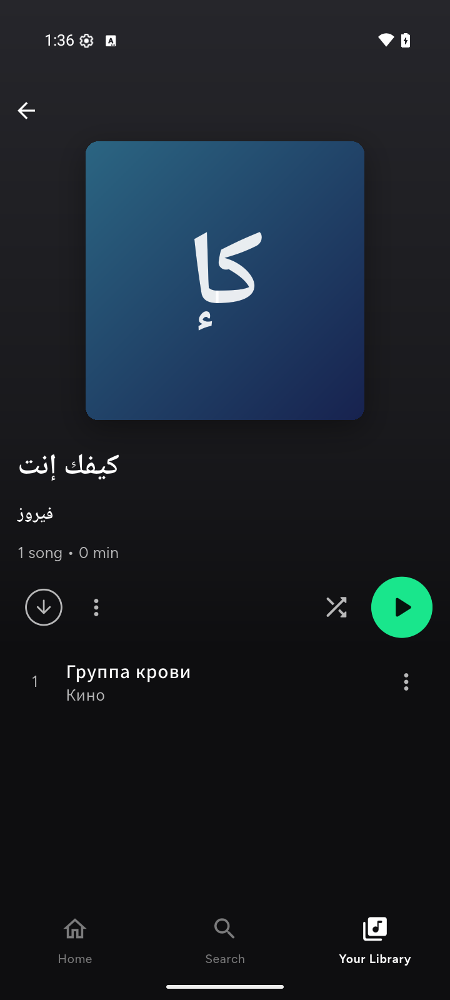
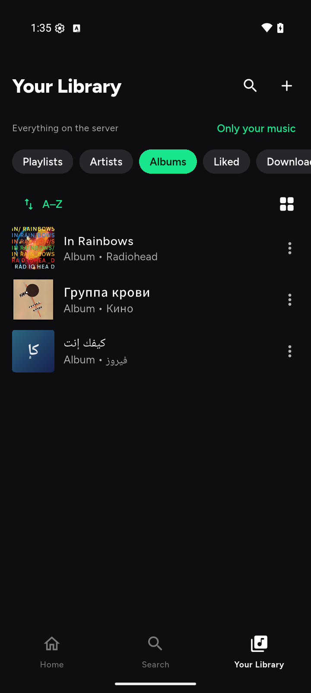

# Evidence: the proof behind the board's marks (history, not instructions)

One file. A proof of what was run, on what, and what it showed; the board's `status.json` and notes cite these by ID (`b04`, `c06`) or by the old file name, and both still resolve: **every old file name is the start of a section heading below and in the table.** The screenshots in this folder belong to these sections.

**Rule for new proofs (so this folder does not fill up again):** a new proof is a **new section at the end of this file** with an `<a id="...">` anchor, an ID (the next `b` for an app walk, `c` for a clean-machine proof; the walk record of the release candidate is `b11`) and a heading that starts with the ID. **Never a new markdown file in this folder.** Agents talk to each other through board notes (`roadmap.py note`), not through files.


| Old file | Section |
|----------|---------|
| `2026-10-30-ux-batch1.md` | [ux-batch1-2026-10-30](#ux-batch1-2026-10-30) |
| `2026-10-30-ux-batch2-and-drawer.md` | [ux-batch2-2026-10-30](#ux-batch2-2026-10-30) |
| `2026-10-22-walk-e1-e2-e6.md` | [walk-2026-10-22](#walk-2026-10-22) |
| `b01-live-channel-two-phones.md` | [b01](#b01) |
| `b02-journey4-two-phones.md` | [b02](#b02) |
| `b03-impostor-and-cold-start.md` | [b03](#b03) |
| `b04-server-away-during-playback.md` | [b04](#b04) |
| `b05-sign-out-and-a-stale-password.md` | [b05](#b05) |
| `b06-no-phone-notifications.md` | [b06](#b06) |
| `b07-signed-addresses.md` | [b07](#b07) |
| `b08-rewalk-of-main-2026-10-30.md` | [b08](#b08) |
| `b09-p220b-rewalk-and-first-download.md` | [b09](#b09) |
| `b10-f21-download-of-a-release.md` | [b10](#b10) |
| `c01-installer-clean-vm.md` | [c01](#c01) |
| `c02-backup-restore.md` | [c02](#c02) |
| `c03-interrupted-install.md` | [c03](#c03) |
| `c04-ytdlp-self-update.md` | [c04](#c04) |
| `c05-funnel-on-a-real-server.md` | [c05](#c05) |
| `c06-install-by-the-guide-bare-vm.md` | [c06](#c06) |
| `c07-download-notification-ask.md` | [c07](#c07) |
| `c08-the-offline-look.md` | [c08](#c08) |
| (new, 6 Nov 2026) the code pass proved on a real server and an emulator | [d01](#d01) |

---

<a id="ux-batch1-2026-10-30"></a>
## ux-batch1-2026-10-30 · 2026-10-30-ux-batch1.md

**UX review, batch 1: the build next to the frame (2026-10-30)**

### UX review, batch 1: the build next to the frame (2026-10-30)

**What this is.** The advisor's order after F46: look at the build screen by screen, name the frame that was drawn for it, and write down where they
differ or where a control is dead, duplicated or misleading, **before any fix**. This is a *review*, not a pass (`docs/tasks/RELEASE-CANDIDATE.md`
section 1): it was not run on the release-candidate pair.

**What was looked at.** An x64 **release** APK, `0.1.0 (build 122 · 1613ae9)` (the head of PR #57: `main` at `f1e27b0` with RC1 batch A on top),
fresh install on the emulator `encore_friend` (Android, 720×1600), signed in as a test person on the dev VM 106. **The dev VM runs the old stack beside
the new server** (people, fetch, quality, recs, admin, soularr, slskd), so what a *fresh* install shows can differ, in particular on friends and Jam. The
rehearsal (`b11`) is where a fresh install is judged. **Session mode:** Diagnostics does not name it (its App line's bracket is the build mode, `release`; **F53**).
The session was in Encore mode by circumstance: the playing song's reference is `sr_…` (`play.audible … source=stream`), Import says "saved on your
server", Your server says "Ready". When it became Encore mode after the sign-in was not timed, so F30 stays *built, not walked*. Pictures: `evidence/2026-10-30-ux1-*.png`. The "Your server" page is described, not pictured
(it shows a private address).

#### The pairs (frame ids from `docs/design/directions/`)

| Picture | Frame | What the build shows | Differences, defects, questions |
|---|---|---|---|
| `ux1-first-run` | S-03 Sign in (S-02 Join, S-06) | "Welcome to Encore", "Got a setup link? Paste it", a collapsed "New here? What is a music server?", Server address / Username / Password, "Add another address (for when you are away from home)", Connect | Typed address (F24). Helper line under Server address is as bright as a label (**F52**). Looks nothing like S-03's Welcome (F46), no change decided for RC1 (D-30) |
| `ux1-home` | S-10 Home | Avatar, "Good evening", bell, gear; chips Playlists / Albums / **Jam**; shortcut tiles; "Your Year in Music" card; shelves "New from artists you play", "Your playlists", "New on the server" | The avatar and the gear open the same page (**F51**, D-27). The Jam chip leads to a dead end (**F50**). No friends shelf on this account (the people service is up on this VM, nobody shares): whether a fresh install shows one is for `b11` |
| `ux1-whats-new` | S-24 What's new | Bell: "Nothing new yet" and a sentence | Fine. #35 (bell) still not walked with real items |
| `ux1-settings` | S-70 Settings (the list) | Search settings; a server card (name, user, "Synced 1 min ago"); Playback, Downloads & storage, Library & sync, Privacy & your music, Import music, Notifications, Lyrics, Appearance, About & credits; below: Switch user, Sign out | One list, readable. "Import music" is one door to the import page; Library's "+" menu (below) is another |
| (not pictured) | S-71 Your server | Music server (Working), "41 songs on this phone", Addresses (Home, In use; Add an address; Check addresses), Play any song (switch, Ready), Lyrics ("Lyrics come from the web: this server does not offer lyrics, so Encore looks for them on the web") | "Check addresses" is drawn as a plain row, not the "Testing…" button of the frame; I did **not** press it, so F40 (the check that looks broken) is neither confirmed nor cleared. Lyrics are fetched by the phone from the web, which is the known thin-client debt (ADR-R38, `docs/30`). Only the top two thirds were looked at |
| `ux1-add-address-dialog` | (dialog, S-71) | "Add an address", hint `100.64.0.5:4533` **grey**, "Name (optional)" label white | **F38's own case is fixed on a real screen** |
| `ux1-settings-privacy` | S-72 Settings pages | "Your library: Only my music / Everything on the server", Home: Show "New on the server", Privacy: **Private listening**, Account: signed in as | The "only my music / everything" choice is **also** on the Library page ("Only your music" / "Show the whole server"), and the words differ (**F41** confirmed). Private listening is here and no longer in the player (D-23) |
| `ux1-settings-downloads` | S-72 | Quality (High, Opus 160), Wi-Fi only, "No downloads yet", Storage limit | Fine |
| `ux1-settings-import` | S-60 Import / S-06 Bring your music | Link field, Import, "Choose a file", "Your imports" | One page; the review's three import screens (M1) were not all reached in this batch |
| `ux1-settings-about` | S-74 About | **"Version 0.1.0 (build 122 · 1613ae9)"**, Open-source licences, Diagnostics | **F34 seen working on a built APK** |
| `ux1-appearance-dark` / `-light` | S-72 | Dark/Light/Follow system; True black enabled in Dark; **greyed in Light with "Only in the dark theme: choose Dark (or a dark phone) first."** | **F42 seen working** |
| `ux1-jam` | S-50 Jam | "Listen together"; "Your server does not have Jam yet. Jam needs a small extra program on the server…" | **F50.** The page is honest, the way in is not |
| `ux1-search` | S-11 Search | "What do you want to listen to?" in a muted colour, Browse all tiles | **F38 seen working** (the hint is quieter than an entry) |
| `ux1-library` | S-14 Your Library | "Only your music / Show the whole server", chips Playlists, Artists, Albums, Liked, Downloaded; A–Z; grid; rows | No row shows a menu (no ⋯); long-press was not tried; D-26 wires them. The "Downloaded" chip runs off the right edge (the row scrolls; nothing says so). Two playlists named "In Rainbows" and four "Sync test" ones are test data |
| `ux1-library-create` | S-22 Create | "New playlist", "Import from Spotify or YouTube Music" | A second door to Import (M1) |
| `ux1-library-downloaded` | S-16 Downloaded | "Nothing downloaded yet" with one sentence of how | Fine |
| `ux1-now-playing` | S-31 Now playing | Cover, title, heart, slider, shuffle/previous/pause/next/repeat, **queue button alone on the right**, no device icon, no share icon | **D-28 seen working.** S-31 still draws the device icon and a share icon: revise the frame |
| `ux1-now-playing-menu` | S-34 Song menu | Remove from Liked Songs, Add to playlist, Play next, Add to queue, Go to album, Go to artist, Sleep timer | **D-23 seen working** (no speed, no Private listening). S-35 still draws "Playback speed": revise the frame |

#### Not looked at yet (captured but not viewed, or not captured)

Settings > Playback, Library & sync, Notifications, Lyrics; Library > Artists / Albums / Liked (captured: `tools/journeys/shots/ux2-lib-*`, not viewed
or committed); an album page, an artist page, search results, the queue, Year in Music, the lyrics view, the playlist ⋯ menu, long-press on any row,
the two invite flows, Switch user, Sign out, the friends and profile surfaces (none seen). The "Jam" page was looked at only in its "no Jam" state.

#### What this batch found (all are rows in `history/reviews-2026-10-31.md#audit`)

* **F50 (RC1, a dead end):** the Home "Jam" chip, on a server without Jam, which is every fresh Encore install. Proposal: show it only where the server has Jam.
* **F51 (RC1, D-27):** the avatar and the gear are one control twice until the "You" page exists.
* **F52 (later):** helper text under a field is as bright as a label (one theme line, with the F39 to F41 batch).
* **F53 (later, the advisor may pull it into RC1):** Diagnostics cannot say which mode the session is in.
* **Decisions (advisor, D-33):** F50 hide every way into Jam where the server has none, in one PR with the friends-surface hiding (F43); F51 is its own small PR after it; F52 with the F39 to F41 batch.
* **Confirmed, already decided:** F41 (two "my music / whole server" controls, with different words), M1 (several doors into Import).
* **Frames to revise before RC2 (F46 pass):** S-31 (device and share icons), S-35 (speed), S-36 (Devices, with P4-07), S-71 ("Testing…").

#### What was seen working on a built APK (not a pass: dev VM, emulator, not the release-candidate pair)

F34 (version line), F38 (hint colour, in two places), F42 (true black), F35/D-23 (the player menu), D-28 (no device icon). Each still needs the
rehearsal on the pair, J13, before the audit calls it done.

---

<a id="ux-batch2-2026-10-30"></a>
## ux-batch2-2026-10-30 · 2026-10-30-ux-batch2-and-drawer.md

**UX review batch 2, and the drawer walked on an emulator (2026-10-30, night)**

### UX review batch 2, and the drawer walked on an emulator (2026-10-30, night)

**What this is.** The rest of the screens the batch 1 record listed as "not looked at", and a walk of the avatar's drawer (PR #60, merged as
`1a30765`). **A review and a walk on an emulator against the dev VM, not the release-candidate pair: it is not a pass**
(`docs/tasks/RELEASE-CANDIDATE.md` section 1). The build was an x64 release APK `0.1.0 (build 122 · ba47e27)` (the head of #60). The dev VM runs the old
stack beside the new server. Pictures: `evidence/2026-10-30-ux2-*.png`.

#### Batch 2: screens looked at

| Screen | Frame | What the build shows | Verdict |
|---|---|---|---|
| Settings > Playback | S-72 | Streaming quality (Wi-Fi: Original, mobile: High), Equalizer, Volume levelling (Off / Song / Album), Quiet places | Readable, no defect for RC1 |
| Settings > Library & sync | S-72 | Songs on this device, last sync, sync while closed, Sync now, Rebuild library | **F54** the last sync is a raw timestamp (`2026-10-30 19:43:04`) |
| Settings > Notifications | S-72 | Three switches, all off, one honest paragraph | Readable. The release check sends artist names to the public catalogue from the phone (known thin-client debt, ADR-R38) |
| Settings > Lyrics | S-72 | Text size, keep screen on | Fine |
| Album page (`ux2-album`) | S-18 | Cover, title, artist, year, N songs, minutes, Download, menu, shuffle, play, numbered rows with their own menus | Matches the frame's intent, no defect |
| Library > Artists, Artist page (`ux2-artist`) | S-19 | Hero, "1 of 15 albums on your server", Popular, Albums | Honest about what the server holds. No defect |
| Queue sheet (`ux2-queue`) | S-33 | Now playing, "Nothing queued" with how to add | **F55** a lone "Save" on the sheet does not say what it saves |
| `/profiles` with one person (`ux2-profiles-one`) | S-05 | "Who's listening?", the person, "Add someone" | The page behind Settings > Switch user; the avatar no longer opens it (D-34) |

#### The drawer (S-27, D-34), walked

| Step | Expected | Got | Verdict |
|---|---|---|---|
| Tap the avatar on Home (one person) | A drawer from the left: name, then only rows that exist | `newtester`; What's new (this server keeps news), Settings, Your server "My music server · Connected", Add account, Sign out. No Jam (no hub), no People (not an owner) | As designed |
| Tap What's new / Settings / Your server | The place opens, the drawer closes, Back returns to Home | All three, each time | As designed |
| Tap Sign out, then Cancel | The same question as Settings ("Sign out of My music server?"); Cancel leaves the drawer open | Yes | As designed |
| Add account (second test person), then the drawer | A "Who's listening" block with both, a check on the active one, "Add someone" instead of "Add account" | Yes (`ux2-drawer-two-accounts`) | As designed |
| Tap the other person in the block | One tap switches; Home and the queue are theirs | Yes | As designed |
| **Sign out from the drawer, as the second person** (advisor's check) | The question, then "Who's listening?" with only the first person, nothing thrown | Yes: landed on "Who's listening?" with `newtester` "Listening now"; no crash and no disposed-reference error in logcat | As designed. The drawer's `ref` lives through `signOut` |

Also seen on the real build: **Home has no Jam chip** (F50 working), and the drawer's Jam row is absent for the same reason.

#### Not done

A drawer with the People and Jam rows on a real server (no owner login or Jam hub on this VM; the widget tests cover them); the drawer on a fresh install
(the accounts list is now started at the app root: `b11`); anything on a real phone.

---

<a id="walk-2026-10-22"></a>
## walk-2026-10-22 · 2026-10-22-walk-e1-e2-e6.md

**Device walk 2026-10-22: E1, E2, E6 on the emulator (build 100, from the new repo)**

### Device walk 2026-10-22: E1, E2, E6 on the emulator (build 100, from the new repo)

Emulator `encore_a07` (Android API 34-ish, 3-button navigation), signed in as the test account, nothing downloaded. Network switched with
`adb shell cmd connectivity airplane-mode enable|disable`. Read from the media session (`dumpsys media_session`) and the screen.

| Check | What I did | Result |
|---|---|---|
| **E6** queue survives a kill | Searched a song the library did not have, played it (3.3 s to sound), let it run 22 s, paused, force-stopped the app, reopened | Mini-player back with the song, paused, progress bar at the saved second (`e6-queue-restored-after-force-stop.png` in this folder) and the lock-screen session shows the same title and 31 s. Before the fix the mini-player was gone. The first build of the day (library lookup without waiting for the session) also restored nothing; the likely cause, a lookup that ran before the session existed (release builds do not log, so this was reasoned, not seen), was fixed and the next build restored the song. |
| **E2** offline taps | Airplane mode on, tapped a song that is not downloaded | One message: "Not downloaded. Connect to play it." The song stayed the same for 11 s (no skip cascade through the playlist). |
| **E2** recovery | Airplane mode off | The waiting song started by itself about 5 s later (the emulator needs that long to bring its network back). |
| **E1** stuck load | Tapped a song and cut the network at once | State BUFFERING for about 10 s, then PAUSED (the 12 s limit); the next tap with the network back played within 1.5 s. |
| **E1** latest wins | Tapped a song, cut and restored the network while it was loading, tapped another song | The new song was playing 1 s after the tap; it did not wait for the stuck load. |

Not covered by this walk: a real phone, mobile data, big-font and 3-button profiles for the messages (P1-12), the greyed rows (P1-09 UI part).

---

<a id="b01"></a>
## b01 · b01-live-channel-two-phones.md

**B-01 — The live channel: one person, two phones (2026-10-22, build 113)**

### B-01 — The live channel: one person, two phones (2026-10-22, build 113)

**Setup.** Two Android emulators (720x1600, host GPU), both signed in as the same person on the dev VM server
(`http://192.168.50.133:4540`, home network). Phone A made the change; phone B was left on the screen where it would show (Your
Library). `tools/journeys/two_phone_timing.py` taps the last step on A and polls B's screen until the text shows. One screen dump
costs about a second, so every time below is an upper bound.

**How it works.** The app signs in once as a *device* (a token kept in the phone's secure storage, reused until the server refuses it),
opens `/encore/live`, and the server pushes `library.changed` to the person's other devices. The app then asks for the changes at once.
While the connection is up the periodic check is a 60 s safety net; when it drops the 3 s check returns and the app reconnects with a
jittered pause (1, 2, 4 ... 30 s). The connection is closed when the app goes to the background.

| Change on A | Shows on B after | Note |
|-------------|------------------|------|
| New playlist "Sync test one" | 2.5 s | first trial |
| New playlist "Sync test two" | 2.5 s | |
| New playlist "Sync test three" | 2.5 s | |
| New playlist "Sync test four" | 2.5 s | |
| Like a song (Liked Songs 4 -> 5 on B) | 2.4 s | unliked afterwards |
| New playlist "Sync test five" | 2.6 s | **after the server container was restarted**: both phones had reconnected within 45 s without any tap |

Before the live channel (the old project's docs/23, B40: not in this repository): checks every 3 s, worst case 7.4 s against the 5 s budget (R-16). The server log shows two
`WebSocket /encore/live [accepted]` lines after the restart (one per phone), and the person has two devices on the server (one per phone, not
one per app start).

**Not covered here.** An import and a resume on one phone appearing on the other; the same over the public address; a phone coming back
from hours in the background; more than two phones.

**Found on the way.** Right after a phone booted, the first open of an invitation said "Can't reach ..." once (no network yet); the app
does not retry by itself (a task for the join screen).

---

<a id="b02"></a>
## b02 · b02-journey4-two-phones.md

**B-02 — Journey 4: one person, two phones, an import, a like and an edit (2026-10-23, build 120)**

### B-02 — Journey 4: one person, two phones, an import, a like and an edit (2026-10-23, build 120)

Journey 4 of `history/reviews-2026-10-31.md#audit`: the same account on two emulators; what is done on one appears on the other. `b01` proved a new playlist and a like; this adds **an import** and **a playlist edit** and records what is **not** there (resume).

#### Setup

| | |
|-|-|
| Phones | two Android emulators (720x1600, host GPU, API 36), fresh install of **build 120** (x64 release built from `main` at `52a7214`; `pm clear` before signing in), the same person signed in on both with the sign-in screen (address, username, password typed from the login file, never printed) |
| Server | the dev VM's Encore server (`encore-dev`, home network; an older image than `main`, no yt-dlp updater), the person `newtester` |
| Phone B | left on Your Library > Playlists, sorted "Recently added", so a new item shows without scrolling |
| Measuring | `tools/journeys/two_phone_timing.py`: taps the last step on A and polls B's screen. One screen read costs about a second, so every time is an **upper bound** |
| Content | the album *The Dark Side of the Moon* (10 songs) as a YouTube Music link, new to this account |

#### Results

| Change on phone A | Shows on phone B after | Note |
|-------------------|------------------------|------|
| Import the 10-song album (tap Import) | **3.3 s** | the playlist row appears with "10 songs" at once (the songs play when tapped; the server saves them in the background) |
| Like the song that is playing (heart in the player) | **2.2 s** | B's Liked Songs went 4 -> 5 |
| Rename that playlist (Rename, Save) | **2.5 s** | the new name shows in B's list |
| The server saving the imported songs | 10 of 10 saved after about 2 min | the server log shows 10 stream look-ups from 21:41:35 to 21:43:36, 8 to 19 s apart (the pacing), each 1.0 to 2.2 s, none refused. A's import list ends with "10 songs, 10 saved on your server" |
| Playing a song on A | audio from the server, "OPUS 141", 2:49 long | |

#### What is not there: resume on the other phone

While A played a song, B (Home and Library) showed **no mini player, no "continue", no sign of it**. This matches the code: the server has `GET/PUT /encore/api/v1/playback` and `/playback/claim`, and the app never calls them (only a mention in the live channel's comment and an upgrade key). It is app work: **P2-08** (playback state and resume anywhere) and **P2-09** (one device at a time), promise N5/N6. Not built inside this journey, on purpose. So journey 4 is **passed for import, like, playlist edit and new playlist; open for resume**.

#### Found on the way

1. **The first screen asks a non-technical person for an IP address** ("For example 192.168.1.10:4533", "Ask whoever set it up for the address, your username and your password"). The plan says the opposite (`15` section 3, A1: scan an invite or paste a link first; manual address only under "Other ways to connect"). The owner raised the same point on 2026-10-23 (how does an ordinary person find a server, as Plex does, with several Wi-Fi networks and several servers?). Written up as **ADR-R40** (`11`) and task **P2-19** (`tasks/P2`), together with a security finding: the app sends the person's credentials to every candidate address before checking whose server it is (see ADR-R40).
2. **A text field's touch area looks smaller than its accessibility box.** On the Import page the field's node in the screen dump is 720x214 centred at y=499, but the field is drawn at y=400 to 486; a tap at the node's centre did not focus it, and the node overlaps the Import button's area (y=529 to 599). Not confirmed as a bug (the field is multi-line and grows); to be looked at with TalkBack in the accessibility task (P1-12).
3. Phone B's layout is about 45 px lower than A's on the same screens (different insets); coordinates cannot be reused between the two phones, so every tap here was taken from a fresh dump.
4. The tool `ui.py swipe x y x y 900` does not make a long press (the app saw a tap and started the song); a tool limit, not an app problem.

#### Not covered

An import and an edit while B is in the background for hours; the same over the public address; a long list or a Spotify list; more than two phones; **resume** (above); a real phone (these are emulators).

#### YouTube look-ups spent

10 stream look-ups by the server for the import (above) and a handful of `ytmusicapi` requests from this PC to find the album's playlist id (3 searches and 4 album pages). No refusal. With the 4 canary runs of `c04` earlier the same day, the home address saw a modest, spaced load.

---

<a id="b03"></a>
## b03 · b03-impostor-and-cold-start.md

**B-03 — Another server at the saved address, and the cost of the check (2026-10-24, build 120 before / slice A after)**

### B-03 — Another server at the saved address, and the cost of the check (2026-10-24, build 120 before / slice A after)

First walk written in the record shape of `07` §12. It checks the rows of `31` that P2-19 slice A built (CN-6, CN-9 to CN-12, CN-15) against the security finding **S2** (the app sent the person's login to every saved address before asking whose server it was) and measures what the check costs the listener (N1, tap to sound from a cold start).

| Row | Setup | Steps | Expected | Got | Verdict | Evidence | If Fail |
|-----|-------|-----|----------|-----|---------|----------|---------|
| CN-11 (old build), CN-6 | **Old build** (`main` at `52a7214`). Emulator A signed in as `newtester`. The only saved address is `http://10.0.2.2:4541`, a program on this PC that answers like a music server (says yes to every Subsonic call, copies the real server's id and public key, cannot sign). The real server is stopped | Cold start, wait 40 s, open Liked Songs, tap two songs | (S2 rule, `31`): no login, token or signed address goes to an address that has not proved who it is | **38 requests reached the impostor, 30 carried the username, the salted token and the salt** (`ping`, `getArtists`, `getAlbumList2`, `getScanStatus`, `library/files`, `/encore/api/v1/me`, **12 `stream`**, **5 `scrobble`**). The app showed no problem strip: it took the impostor for the server | **Fail** | `b03-impostor-log-old-build.jsonl` | **S2**, fixed by slice A (the next row) |
| CN-9, CN-10, CN-11, CN-12 | **New build** (slice A, build 120 from `7b44305`). Same phone, same list `[Impostor]`, real server stopped (so the Home address the server had told the phone, CN-15, is dead too) | Cold start, wait past the 4 s grace, tap Try again, open Liked Songs, tap two songs | The phone asks the public question `GET /info?challenge=…` and nothing else; the answer's key matches the id but the signature does not verify (wrong key); the impostor is never sent a login and is not used; the strip says "Can't reach your server." with Try again; songs the phone has still show | **18 requests: 16 `GET /encore/api/v1/info?challenge` and 2 unauthenticated `GET /api/info` (the instant-play and Jam look-ups, see F-1), 0 with a credential, a header or a body.** The strip "Can't reach your server." and "Try again" were on screen over Liked Songs; "Your server" said "Not reachable" | **Pass** | `b03-impostor-log-new-build.jsonl` | — |
| CN-11 (typed form) | New build, the list has the real server (Home) and the impostor | Open "Check addresses" | The address that proves its key answers with its time; the other says it does not answer | Home: 160 ms; Impostor: "No answer" (the same word an address that is off gets, nothing about keys is told to a listener). With only the impostor: "Your server did not answer. Songs it already has still play." | **Pass** | the walk of 2026-10-23 on emulator A (screens in the chat, not kept) | — |
| CN-13, strip | New build, real server saved and stopped (`docker stop encore-server`), the phone running | Wait | The strip appears within 40 s; after the server is back and Try again is tapped, it goes | Strip after under 40 s (waited by `ui.py wait`, 40 s limit); gone after Try again | **Pass** | the same session | — |
| CN-15 | New build, the typed list is `[Dead 192.168.50.250:4540]`, the real server is running | Open "Your server" | A saved address nobody answers at does not take the app down if the server named another address | "Signed in as newtester - Home (192.168.50.133) - Working" while the ADDRESSES list shows only Dead: **no strip**, music streams. First read as a regression of the strip; it is the learned address (`capabilitiesJson.learnedAddresses`) at work. Stopping the real server makes the strip appear | **Pass**, with finding F-2 | — | F-2 |
| N1 (`07` §3) | **Same emulator, same session**, the real server running, address `[Home]`. Old build, then the new build installed over it | `tools/journeys/cold_start_timing.py 5`, twice per build: stop the app, start it, open Liked Songs as soon as Home is drawn, tap a song that streams, time until media session PLAYING and a started AudioTrack. Songs rotate (Breathe, Reckoner, QUE CE SOIT, Nude, Weird Fishes) in the same order for both builds | The check does not slow the first song (no more than 10 % over the old build) | **Old build, 10 cold starts: median 2.97 s, 2.36 to 3.39 s. New build, 10 cold starts: median 2.87 s, 2.31 to 3.27 s.** (Runs: old 3.33, 2.97, 2.72, 2.43, 3.39, 2.36, 3.04, 2.74, 2.97, 3.26; new 2.65, 2.31, 3.27, 2.63, 3.25, 2.88, 2.44, 3.01, 2.85, 2.96.) Home is drawn 7 to 9 s after launch on both: this emulator's cold start, not the check | **Pass** (no measurable cost; the spread inside one build, about 1 s, is larger than the difference between builds) | `tools/journeys/cold_start_timing.py` output above | — |

#### Setup in detail

| | |
|-|-|
| Phone | emulator A (`emulator-5556`, 720x1600, API 36, x64), the old build and the new build installed one over the other with `adb install -r -d` (same database version 7, `git diff 52a7214 HEAD -- app/lib/data/db` is empty) |
| Server | the dev VM's Encore server with slice A's code (id `l2tkw2ujmhueoyz263qgicxfyu`), person `newtester`; stopped and started with `docker stop/start encore-server` over `ssh encore-dev` |
| Impostor | `tools/journeys/impostor_server.py REAL_ID REAL_KEY 4541 LOGFILE` on this PC (the emulator reaches the PC as `10.0.2.2`). It writes **only the names** of the query parameters and of the headers that could carry a login, never their values, so the log holds no secret and is kept as evidence |
| Why the real server was stopped | The first runs (2026-10-23) had the real server up: the phone then also had the Home address the server had told it (CN-15) and used that one, so the impostor was never the only thing answering. The attacker's situation is *the real server cannot be reached and somebody else answers at the saved address*, which is what this walk sets up |
| Not repeated here | the old build's sign-in screen, the password (typed with `ui.py typefile`, never printed) |

#### Findings that are not rows

* **F-1: look-ups that carry no login still go to an address that has not proved itself.** With the impostor the only saved address, the new build still sent it two `GET /api/info` (the look-ups for the "play any song" service (`fetchServiceProvider`, `fetchInfoProvider`) and for the Jam hub (`jamServiceCandidates`) build their addresses from the saved list, not from the verified one; which of them sent these two was not separated). They carry nothing, so S2 stands closed; but it breaks the rule that a phone talks to an address only after it proved itself, and on a plain (non-Encore) server the same look-up is followed by `/api/play` with the Subsonic token (`fetch_client.dart`, `instantBackendProvider`), which a program at the saved address could receive. Encore servers play songs through their own API (`EncoreInstantBackend`), so the exposure is the legacy path only. **Task:** make both look-ups use `endpoints.currentUrl` (or skip when it is the unverified address), and ask the Encore server for what these services are (`ADR-R38`: the app talks to its own server); a legacy server keeps today's behaviour, documented as unprotected in `31`.
* **F-2: learned addresses are invisible.** "Your server" lists only what the person typed. The phone also uses the addresses its server told it (Home, Away), so deleting a typed address does not stop the phone using the same one, and the person cannot see it (this is what looked like a regression). `31` gets an open row (O-8): list them under "From your server" with a way to say *don't use this one*.
* **F-3: the old build never showed a problem while it was talking to the impostor.** A wrong server is indistinguishable from the right one in the old build, which is the point of S2. In the new build the strip is the only sign, and it says "Can't reach your server." (O-6 decided: a specific line for a wrong key, still to be built).
* **F-4: a tool slip.** `ui.py tap "Add" 1` matches the dialog title "Add an address" before the "Add" button; tap the button's coordinates after a `dump`. No app problem.

#### Not covered

A real phone on a real café network (the LAN multicast and the network-change race need one, slice C); an impostor that copies the **whole** real answer including a replayed signature (the unit tests cover it: a recorded answer is useless the second time, `server_identity_test.dart`); the Away (Funnel) address with an impostor; a plain (non-Encore) server with an impostor, which cannot be protected (it has no key); mobile data.

#### YouTube look-ups spent

None. All songs were already on the server or on the phone.

---

<a id="b04"></a>
## b04 · b04-server-away-during-playback.md

**B-04 — The server goes away while a song is asked for or playing (2026-10-24, G-1, build 120 from `task/G-1-wait-for-the-server`)**

### B-04 — The server goes away while a song is asked for or playing (2026-10-24, G-1, build 120 from `task/G-1-wait-for-the-server`)

Second walk in the record shape of `07` §12, and the first with **a fault produced on purpose** (ADR-R41 T4): a Toxiproxy between the emulator and the dev server takes the server away and back (`tools/journeys/fault_walk.py`). Rows checked: `33` PB-F7, PB-F8 (and `31` CN-14, the strip). Expected comes from those rows: *the song waits, nothing hops, it carries on by itself when the server answers, within 5 s* (`07` J-07).

| Row | Setup | Steps | Expected | Got | Verdict | Evidence | If Fail |
|-----|-------|-------|----------|-----|---------|----------|---------|
| PB-F7 (old behaviour, from the code) | main before G-1 | a song fails while the phone has a network and the server does not answer | (the row's "Wanted") wait like PB-F1, do not hop | not walked on the old build: the code treated it as a bad song, one quiet retry, "Couldn't play …", the next song (docs/33 as written on 2026-10-23) | **Fail** (by reading the code, not by a walk) | `33` as of `73486fb` | S3 (a run of error notices and a stopped queue on every server restart) → G-1 |
| PB-F7 | **New build.** Emulator A signed in through the proxy (the only saved address is `http://192.168.50.133:4550`; the server's `ENCORE_HOME_URL` points at the proxy so the phone learns no way round it). The proxy is **down** before the tap | Home, open the album *The Dark Side of the Moon*, tap *Breathe (In the Air)* | A sentence once, not an error; the song stays; no "Couldn't play …"; no hop; the strip says "Can't reach your server." | **"Waiting for your server." on screen 3.7 to 4.3 s after the tap** (4 runs: 3.5, 3.7, 3.8, 4.3 s), the play button paused, the title unchanged for the 8 s more the server stayed away, no error notice, the strip "Can't reach your server." over the album | **Pass** | `fault_walk.py pb-f7` timeline (below) | — |
| PB-F7 → resume | the same, the proxy brought **up** | wait | Plays by itself within 5 s of the server being back (`07` J-07) | Audible **11.1 s** after the server was back with retries at 2, 4, 8, then every 15 s; **6.3 s** with 1, 2, 3, then every 5 s; **7.5 s** with the final 1, 1, 2, then every 3 s but sampled only every 3.7 s (the screen read); then **4.9 s** on the final build sampled every 0.7 s (retries at 1, 1, 2, then every 3 s) | **Pass** on the final build (4.9 s, within the 5 s bound; the margin is small: one retry step of up to 3 s, one look at the addresses and the load of the song) | `fault_walk.py pb-f7`, final run | — |
| PB-F8 | Final build. The proxy cuts every connection after 300 kB (so a short song cannot be buffered whole), then goes **down** 3 s after the sound starts | Tap *Brain Damage* (3:48), wait for sound, take the server away for 8 s after the music stops, bring it back | The buffered seconds play; then "Waiting for your server."; **the song does not change**; when the server is back the song carries on | The buffer lasted **75 s** (110 s in an earlier run; the player's own retries then give up). Then "Waiting for your server.", the title stayed *Brain Damage* for the whole 8 s, and the sound was back **4.7 s** after the server was | **Pass** (the position the song resumed at could not be read on the phone: the media session's position is not a live clock; it is pinned in the unit test, `+42s`) | `fault_walk.py pb-f8` timeline | — |
| PB-F8 (first build of G-1) | Same, before the fix below | same | same | **Fail:** after the failure the Android player **moved to the next song by itself** (*Brain Damage* became *Breathe (In the Air)* while "Waiting for your server." was on screen), and when the server returned it played *Breathe* | **Fail** → fixed in the next commit | the timeline of that run (below) | S3 (a hop that skips a song on every server restart) → `playback_engine.dart` `_onBackendIndex` now ignores an index event once the engine has unloaded the window; test `PB-F8: the platform player hopping to the next source after the failure does not move the song` (fails without the fix: `t2` instead of `t1`) |

#### What the walk found that no test could

On Android, `just_audio` (ExoPlayer) answers a failed source by `seekTo(next); prepare(); play()`. The engine's `_onBackendIndex` cannot tell that from a song that ended and moved on (a gapless advance), so the queue followed the player to the next song. Every unit test used a fake backend that never did this. The fake now has `failCurrentAndHop()` and the case is pinned. This is the kind of thing T4 exists for.

#### Timeline of the first PB-F8 run (the hop), abridged

```
[ 16.6s] proxy DOWN
[ 27.0s] player PLAYING  audible=True   'Brain Damage'  screen: Can't reach your server.      (the buffer plays; the strip is honest)
[145.0s] player BUFFERING audible=False 'Brain Damage'  screen: Waiting for your server.
[149.1s] player BUFFERING audible=False 'Breathe (In the Air)'                                   <- the hop
[160.2s] proxy UP
[167.4s] player PLAYING  audible=True   'Breathe (In the Air)'
```

#### Final PB-F7 run

```
[  0.4s] proxy DOWN
[  8.1s] tap 'Breathe'
[ 12.6s] screen: Waiting for your server. | Can't reach your server.        (4.3 s after the tap)
[ 15.4s] player PAUSED  'Breathe (In the Air)'
[ 21.9s] proxy UP
[ 26.8s] player PLAYING audible=True 'Breathe (In the Air)'                  (4.9 s after the server was back)
```

#### Setup in detail

| | |
|-|-|
| Phone | emulator A (`emulator-5556`), x64 release build of the branch, **signed in again** after `pm clear` through `192.168.50.133:4550` (so the new typed form, the key check and trust on first use ran for real); notifications allowed |
| Server | the dev VM's Encore server with slice A (same id `l2tkw2ujmhueoyz263qgicxfyu`), person `newtester` |
| Fault proxy | `ghcr.io/shopify/toxiproxy:2.12.0` as the container `toxiproxy` on the dev VM (host network, control API on `127.0.0.1:8474`), proxy `encore`: listen `0.0.0.0:4550`, upstream `127.0.0.1:4540`; "down" is `enabled:false` (connections refused at once); the 300 kB cut is a `limit_data` toxic. The server's `ENCORE_HOME_URL` was `http://192.168.50.133:4550` for the walk, so the phone cannot learn a way round the proxy (a first attempt with the direct address left the phone reaching the server whatever the proxy did: the learned address at work, `evidence/b03`) |
| Measuring | `fault_walk.py` reads the media session and the audio system as `play_timing.py` does ("audible" = PLAYING and a started AudioTrack), the screen only every 3 s (a screen read costs about 3 s); **times of things only the screen shows are good to 3 s, times the player shows to about 1 s** |
| Songs | owned (the server's own library); no YouTube look-ups |

#### Findings that are not rows

* **F-1: the stall is noticed late.** The buffered part of a song keeps playing for 75 to 110 s after the server went away, then the player's own retries give up and the engine learns of it. During that time the strip says "Can't reach your server." and the music plays; this is honest, and the player's own retries are better placed to recover a short outage than ours. A quicker "Waiting for your server." while the buffer drains was considered and not done (it would second-guess ExoPlayer's retries).
* **F-2: the media session's position reads 0 or stale on the phone** (`dumpsys media_session` is not a live clock), so "carries on from where it stopped" is proved by the unit test, not by the walk. A cheap way to read the real position on a device (the app's own diagnostics) would make it checkable (open).
* **F-3: the first walk attempts failed for setup reasons worth keeping:** the direct address learned from the server bypassed the proxy; the album's lowest rows sit under the mini player so their taps never land (use rows 1 to 4); an 8 to 15 s retry delay made the resume 11 s. A screen dump taken after typing into the wrong field **printed part of the dev test account's password**; it was rotated at once (`tools/rotate_password.py`, never prints it) and the form is now filled with TAB between fields.

#### Not covered

The server restarting at the same time as a network change (Wi-Fi to mobile); the Away (Funnel) address; a slow server rather than an absent one (the 12 s load limit, PB-F6, has unit tests only); a Jam song; a song from the catalogue that the server fetches (it needs YouTube look-ups); a real phone; resume after the app was killed while waiting.

#### YouTube look-ups spent

None.

---

<a id="b05"></a>
## b05 · b05-sign-out-and-a-stale-password.md

**B-05 — Signing out ends the phone's device on the server; a phone with an old password locked the account (2026-10-24, D-5)**

### B-05 — Signing out ends the phone's device on the server; a phone with an old password locked the account (2026-10-24, D-5)

Third walk in the record shape of `07` §12. Rows: `32` DV-2 (revoked: sign out), `31` CN-24 (the login is refused), `32` AC-21 (an account is locked after twenty wrong tries) and DV-4 (a lock ends all the person's devices).

| Row | Setup | Steps | Expected | Got | Verdict | Evidence | If Fail |
|-----|-------|-------|----------|-----|---------|----------|---------|
| DV-2 (before) | `main` at `efd41d8` (by reading the code and the walk list of 2026-10-23) | the person signs out | the device is revoked on the server | the app never called `POST /auth/logout`; the dev account (`newtester`) showed **four active devices** after several sign-outs and `pm clear`s, two of them `Android phone` entries of phones that no longer existed | **Fail** | `devices_of.py` output of 06:12 | S3 → D-5 |
| DV-2 (server) | the server tests | `POST /auth/logout` with the music server's login (the way the app asks) and another person's device id in `X-Encore-Device` | only the caller's own device is ended | **Fail** before the change: the id in the header was revoked whoever owned it (the endpoint only checked the id's shape, unlike `DELETE /me/devices/{id}`) | **Fail**, fixed | `test_dv_2_signing_out_never_ends_somebody_elses_device` (fails without the fix, `api.py` `logout` now has `AND person = ?`) | S3 (needs the other person's device id, 26 random characters) |
| DV-2 | **New build.** Emulator A signed in as `newtester` at `192.168.50.133:4540`; the server lists 1 active device (`Android phone`) | Home, Settings, scroll to the bottom, Sign out, confirm | The phone shows the first screen; the server lists **0** active devices for the account; nothing else of the person is touched | The first screen ("Welcome to Encore") appeared; **`GET /me/devices` went from 1 to 0**, the database row of that device has `revoked_at` set; the failed-login counter stayed 0 | **Pass** | `tools/journeys/devices_of.py` before and after (above), the device table | — |
| DV-2 (offline) | unit test | sign out with the server unreachable | the phone still signs out; the device stays valid on the server until ended from another device (DV-3) | passes: the saved sign-in is deleted, the call is given 5 s and its failure ignored | **Pass** (unit test; not walked on a phone) | `DV-2: signing out with no connection still forgets the sign-in, and says the server was not told` | — |
| CN-24 / AC-21 (found by accident) | The second emulator (B) had been signed in as the same person since journey 4 (`b02`), with the **old password**; the test password was rotated about five hours earlier (a leaked password, `b04` F-3), which signed B's device out | nothing: B's live channel tried to renew its device sign-in | A refused password shows the "Sign in again" card and stops (`31` CN-24) | **B tried the old password again and again** (its live channel renewed the device sign-in with the stored password at every reconnect, 1 to 30 s apart): `failed_logins` reached 20 over the following five hours and the server **locked the account**; after the unlock the counter went 1, 3, 8 in under three minutes while B was awake (`This account is locked.`, DV-4: all its devices revoked). Nobody noticed on B (its screens showed "Synced 4 h ago") | **Fail** | the account row, `devices_of.py` ("the server said: This account is locked."), the device table | S2 (a stale phone locks the owner out of their own account) → the fix below |

#### The fix to the stale-password lock (same pull request)

* `EncoreDevice.token()`: a password the server **refused** is not sent again for 15 minutes (four tries an hour, far from the twenty that lock), then tried once more in case the server was only busy. A new sign-in makes a new object with the new password.
* `EncoreApi.login` returned an `UnexpectedFailure` for a 401 (it did not go through the server's error mapping): a refused password is now an `AuthFailure`, which is what the phone's other code already expects (`31` CN-24).
* Test `CN-24: a password the server refused is not tried again for a while (twenty wrong tries lock the account)`: six calls over five minutes make one login.
* Not walked on a phone after the fix (it needs a phone that holds a wrong password again): the unit test and the incident are the evidence. **Open:** nothing tells the person on B that its login was refused (the "Sign in again" card is for the music-server login that sync uses; the live channel's refusal is silent). Written down for P1-12/P2-18.

#### Setup in detail

| | |
|-|-|
| Phones | emulator A (`emulator-5556`, build 120 of the branch, signed in again after `pm clear`), emulator B (`emulator-5558`, an older build, signed in as the same person; signed out by hand during the walk through its own Sign out, which ended its device on the server only if it had a valid one, and it did not) |
| Server | the dev VM's Encore server (slice A), people `newtester` (owner), `friendone`, `walkerthree` |
| Measuring | `tools/journeys/devices_of.py` (asks `GET /me/devices` with the token login, so it adds no device; prints ids, names, last seen, never a secret); the dev database read inside the server container for `revoked_at` and `failed_logins` |
| Songs | none played |

#### Findings that are not rows

* **F-1: a phone signed in with an old password is invisible to its owner.** B showed a normal Home for hours. The sign-in card of CN-24 comes from the music-server login that sync uses; B's sync evidently kept working through the music server's own check or was quiet, so nothing said "sign in again". To investigate with the open item above.
* **F-2: the same password reached a screen dump** (`b04`, F-3): rotated at once; this is why the account was rotated and why B's old password was wrong in the first place. A password rotation therefore **must also sign out or re-sign-in every phone that holds the account** (a checklist line in `local/credentials-map.md`).
* **F-3: `ui.py` taps by coordinates went wrong twice** (the dialog's Sign out button is at different y on the two emulators): always take the coordinates from a fresh dump of that phone.

#### Not covered

Sign out while a song is playing from the server (the playback is stopped first; not timed); sign out on a plain (non-Encore) server (no device exists; the step does nothing); the person's device list screen in the app (does not exist, DV-3/DV-5); a phone that is signed out while the server restarts.

#### YouTube look-ups spent

None.

---

<a id="b06"></a>
## b06 · b06-no-phone-notifications.md

**B-06 — No phone notification unless the person asks, and the media controls still show (2026-10-24, ADR-R44)**

### B-06 — No phone notification unless the person asks, and the media controls still show (2026-10-24, ADR-R44)

Fourth walk in the record shape of `07` §12. Expected comes from `11` ADR-R44: nothing is posted to the phone by default; Android's notification permission is asked only when the person switches a category on; the media controls of a playing song are not affected (a media session is exempt on Android 13 and later: **to be verified with the permission denied**).

| Row | Setup | Steps | Expected | Got | Verdict | Evidence | If Fail |
|-----|-------|-------|----------|-----|---------|----------|---------|
| ADR-R44 (before) | The build of 2026-10-24 morning (`main`), Android 16 emulator | Sign in as a new person | (what it did) | "Allow Encore to send you notifications?" appeared **straight after the first sign-in** (seen in the walks of `b04` and `b05`), because the three alert switches were on by default | **Fail** | `b04` setup, the dialog dump | S3 → this change |
| ADR-R44 | **New build** (`task/notifications-off-by-default`, release x64). `pm clear`, then `pm revoke app.encore.player android.permission.POST_NOTIFICATIONS`. Emulator A, the dev server | Sign in with the form (address, name, password) | Home appears with **no permission dialog** | Home appeared; no dialog; `dumpsys package` shows `POST_NOTIFICATIONS: granted=false` | **Pass** | the run of this walk | — |
| ADR-R44, media controls | The same phone, the permission still denied | Open *The Dark Side of the Moon*, tap *Brain Damage* | The song plays and the media notification (lock screen and shade controls) still exists | Playing (`player_state`: PLAYING, audible); `dumpsys notification` lists the app's notification on the channel `app.encore.player.playback`, category `transport`, 3 actions, flags `FOREGROUND_SERVICE`, while the permission is `granted=false` | **Pass** | `dumpsys notification --noredact`, `dumpsys package` | — |
| ADR-R44, defaults | unit test | read the settings of a new install | the three alert switches are off | `alertsOnServer`, `alertsReleases`, `alertsImports` all `false` (and the background job reads the same defaults); switching one on still asks for the permission | **Pass** | `settings_wording_test.dart` (Notifications holds the three switches...), `alerts_service_test.dart` | — |

#### What this does not do yet

* **The in-app bell does not exist in the app** (S-24 What's new is drawn, not built). With all phone alerts off by default, the new-release and "new on your server" alerts have **no place to appear** until the bell is built (P2-15). They are not lost: the person can switch them on in Settings > Notifications.
* Three switches remain on the page; ADR-R44 says at most two opt-in categories ("Jam invitations" first). The page is trimmed when the bell and Jam notifications exist.

#### Setup in detail

| | |
|-|-|
| Phone | emulator A (`emulator-5556`, API 36, x64), release build of the branch, `pm clear`, permission revoked with `pm revoke` before the first start |
| Server | the dev VM's Encore server, person `newtester`; the password typed with `ui.py typefile` and TAB between fields (never printed) |

#### YouTube look-ups spent

None (an album of the server's own library).

---

<a id="b07"></a>
## b07 · b07-signed-addresses.md

**B-07 — In Encore mode a song and a picture come by the server's signed address, with no login of the music server in either (2026-10-25, P2-20 slice 2)**

### B-07 — In Encore mode a song and a picture come by the server's signed address, with no login of the music server in either (2026-10-25, P2-20 slice 2)

Fourth walk in the record shape of `07` §12. Rows: `tasks/P2-songs-as-references.md` P2-20 slice 2 ("Proof"): songs, pictures, the quality extras, and the time to sound (N1).

| Row | Setup | Steps | Expected | Got | Verdict | Evidence |
|-----|-------|-------|----------|-----|---------|----------|
| Songs, no `/rest/stream` | Emulator A (`emulator-5556`, release build of the branch over the old build, signed in as `newtester`), dev VM server with the branch's code and its access log switched on **in the dev copy only** (restored afterwards) | Cold start; Your Library, Liked Songs; tap each of the five kept songs, twice round | every play asks `GET /refs/{ref}/stream-url` at most once per song and then plays `GET /encore/stream/{ref}`; no `/rest/stream`, no `/rest/download` | 5 `stream-url` for 5 songs (the second round asked none: the address was remembered), 38 `/encore/stream/{ref}` (26 `206`, 12 `200`), **0** `/rest/stream`, **0** `/rest/download` | Pass | request summary below |
| Pictures, no `/rest/getCoverArt` | same, the app's caches trimmed (`pm trim-caches`) and the app force-stopped, then started | Home opens; wait 20 s | one ticket (`GET /covers/pass`), every picture by `GET /encore/cover/{id}` with that ticket | 1 `covers/pass`, **80** `/encore/cover/{id}` (all `200`), **0** `/rest/getCoverArt` | Pass | request summary below |
| Pictures on screen | same | look at Home | covers are drawn, not letters | Home shows the covers of the albums, playlists and the mini player (screenshot `new-home3`) | Pass | the screen |
| The address carries no login | unit and session tests | write a picture address and a song address | no `u`, `t`, `s` parameter | `session_encore_test` ("P2-20: in Encore mode a picture is asked for with the cover ticket…", "…a song is played from the server's signed address…"); the request summary shows the phone sent no `/rest/stream`, `/rest/download` or `/rest/getCoverArt` at all | Pass | tests; request summary |
| Quality extras | server test | `maxBitRate=128&format=mp3&estimateContentLength=true` on a kept song's address | passed on to the music server; a bad value refused in words | `tests/test_kept_files.py` (3 tests) | Pass | tests |
| N1, tap to sound, kept song | same phone, same five songs, ten taps | `tools/journeys` timing of tap to "audible" (the media session says PLAYING and the audio system has a started track) | not worse than before | **before** (the build on the phone before the install): median 1.42 s, min 1.32, max 2.05; **after**: median 1.40 s, min 0.99, max 4.20 (the first tap of the run; see F-1) | Pass (median); F-1 open | timing script output below |
| N1, first tap after a cold start | force-stop, start, wait 20 s, Liked Songs, tap | one tap on a kept song | not measured before (the old build was overwritten) | 2.14 s and 2.35 s | Recorded, no baseline | — |

#### Request summary of the phone (dev server, masked; paths with ids written as `ID`/`REF`)

```
 80 GET /encore/cover/ID 200
 26 GET /encore/stream/REF 206
 12 GET /encore/stream/REF 200
 10 GET /rest/scrobble 200
  7 GET /encore/api/v1/info 200
  5 GET /encore/api/v1/refs/REF/stream-url 200
  4 GET /rest/getScanStatus 200
  4 GET /encore/api/v1/library/changes 200
  1 GET /encore/api/v1/server 200
  1 GET /encore/api/v1/library/files 200
  1 GET /encore/api/v1/covers/pass 200
```

What still goes to the music server's `/rest` from this phone in Encore mode, and so is the work of the next slices: `getScanStatus` (the browse index probe), `scrobble` (the "now playing" mark, ten calls), and what is not in this list because it was not done in the walk (`getArtists`/`getAlbumList2` when the library changed, playlists of the old path, `getSong`/`search3` of the instant-play resolver).

#### Timing

```
before (old build, 2 rounds of 5)            after (this build, 2 rounds of 5)
round 1: 2.05 1.67 1.45 1.84 1.53            round 1: 4.20 2.17 1.12 0.99 1.39
round 2: 1.38 1.32 1.38 1.37 1.35            round 2: 1.99 1.36 1.41 0.99 1.43
n=10 median 1.42 s (min 1.32, max 2.05)      n=10 median 1.40 s (min 0.99, max 4.20)
```

#### Findings

* **F-1: one slow first tap (4.2 s) after the install.** The three runs after it (the second round, and two cold starts at 2.14 s and 2.35 s) did not repeat it. It is the first tap of the run, right after a long idle of the emulator; the likely cause is the cold engine plus the first signed address (a round trip), not the address itself (the server answers it in milliseconds on the LAN). Not proved; `play.audible` spans (P1-06) in a profile build would say. Watch it in the five-day use.
* **F-2: this branch predates #29**, so the build asked for Android's notification permission at first start. Not a defect of this change (main has the three alerts off); the walk dismissed it.
* **F-3: `pm clear --cache-only` hangs on this emulator image**; `pm trim-caches 999G` works and was used.
* **F-4: the server's access log is off by design** (it would hold titles and logins); for this walk it was switched on in the dev VM's copy of `__main__.py` and put back by deploying the branch's code again. Credentials were masked in everything read.

* **F-5: an address now runs out (6 hours), a `/rest` token address never did.** Read, not walked: (1) *the player*: a song that fails because its address ran out goes through `_onBackendError`, whose one quiet retry calls `_loadCurrent`, which asks the resolver again, which asks `StreamAddresses.forRef`: the remembered address has run out by then, so a new one is fetched (a pause overnight resumes after a retry of a second). The quiet retry is given back once a song has played (`_retried.remove`). (2) *The phone's clock*: the expiry is the server's own `expiresAt - serverTime` counted on the phone's clock (`EncoreApi._expiry`, test "an address lives as long as the server says it does…"), so a phone whose clock is hours out neither keeps a dead address nor drops a good one. (3) *Downloads*: the address is built when a download is started (`_startOne`), and only when the policy allows a transfer (Wi-Fi), so it is fresh; a transfer that the system stops and resumes for more than 6 hours on the same task would fail and need the person's retry (the manager re-queues only `queued` rows). Accepted for now, to watch in the five-day use.
* **F-6: covers drawn before the ticket arrives.** The placeholder address and the real one share one cache key, and `CachedNetworkImageProvider` is equal for equal keys, so the image would have stayed as it was. The resolver now says `ready`, and the image widget is keyed on it (`test/features/cover_pass_widget_test.dart`: the key changes once, when the ticket arrives, and not at each rebuild; a ticket renewed later does not rebuild the pictures).

#### Not covered

A kept song downloaded for offline (the code path is the same signed address with the quality extras; unit-tested only); a signed address that expires during a song (the margin is 10 minutes of the 6 hours; unit-tested); a cover ticket that expires while the app is open (renewed on return to the app; unit-tested); the phone away from home on the public address; the impostor server (`b03`) run against this build.

#### YouTube look-ups spent

None (all songs were kept songs).

---

<a id="b08"></a>
## b08 · b08-rewalk-of-main-2026-10-30.md

**B-08 — A re-walk of what the notes call done, on `main` (2026-10-30)**

### B-08 — A re-walk of what the notes call done, on `main` (2026-10-30)

The owner doubted that what the status notes call done is done. This walk repeats the headline claims on **`main` at `346bd75`**, in the record shape of `07` §12, instead of quoting earlier walks. It also diagnoses two of the owner's findings of the same day (`history/reviews-2026-10-31.md#audit` F21, F22) and records new ones (F25 to F28).

#### Setup (what exactly was walked)

| | |
|--|--|
| Server | The dev server (my own test machine). Its container was built from the branch of PR #33 (three Python files differ from `main`: `api.py`, `auth.py`, `navidrome.py`). To avoid a rebuild that would have competed with the owner's install for the shared line, **`main`'s three files were copied into the running container and the server restarted**; the 48 Python files of the package then had **the same SHA-256 as `main`'s** (`git archive` of `server/encore_server`). The Dockerfile and the dependencies are the same as `main`'s. yt-dlp 2026.10.26 (stored copy) |
| App | An x64 **release** APK built from a clean tree at `346bd75` (2026-10-30 10:38). `pubspec.yaml` still says `0.1.0+120`, so the build number cannot identify it; the commit and the time do |
| Phone | Android emulator, API 36, x64, **headless with software rendering** (the windowed emulator never got as far as starting the guest), so timings are **not comparable to the earlier runs on the host GPU**. `pm clear` before signing in; notifications revoked; the form filled with `ui.py` (the password with `typefile`) |
| YouTube look-ups spent | At most 4 (two songs of the first download tap in F21, one of the second; the song in (c) had already been fetched by the first tap); the server's own check at start counts as at most one more. Nothing was done from the owner's server |
| Not covered | A real phone, an arm64 build, the away-from-home address, `funnel`, resume on another device, a phone call or Bluetooth cut, anything offline, and every walk of the owner's own server |

#### Rows

| Row | Setup | Steps | Expected | Got | Verdict | Evidence |
|-----|-------|-------|----------|-----|---------|----------|
| (a) first sign-in, ADR-R44 | fresh install, notifications revoked | sign in with address, name and password | Home with the library, **no** permission dialog | Home shows Liked Songs, Your Year in Music, "New on the server" and album covers; no dialog; Settings > Library & sync: 40 songs on the device. **But Liked Songs showed 0 songs at the first look**, and 5 after the second sign-in (the server's 5 live likes; its sixth is an unliked song, F27 retracted) | **Partial:** the sign-in and "no dialog" pass; the empty Liked Songs at the first look is unexplained | the screens |
| (b) N1, a song the server holds | open the album *The Dark Side of the Moon*, four rows twice (the fifth sits under the mini player) | tap a row, time tap to audible (media session PLAYING for the song **and** a started AudioTrack) | 0.7 s target, 3 s hard limit | **n = 8, median 1.45 s, min 1.21, max 1.73** (`b07`, host GPU, n = 10: median 1.40) | **Pass** for the hard limit; the 0.7 s target is not met, and is where it was | the script's output |
| (c) a catalogue song, full length | *April Suzanne (Cover Version)*, Beach House; **already fetched by the F21 download tap about 7 minutes earlier**, so this is *not* a cold look-up | tap, time to audible, keep it playing | audible within 10 s (2 s target); the full song, not the 30-second snippet | **3.79 s** (n = 1); the player shows **0:47 of 3:45** about 46 s after the tap | **Pass for "the full song, not the snippet"** (0:47 of 3:45). The 3.79 s is **not** evidence for N2: a cold look-up was **not re-measured** today | `b08-c-catalogue-song-player.png` |
| (d1) PB-F7, the server is away at the tap | a song never played on this install (*QUE CE SOIT CLAIR*); `docker stop encore-server` before the tap | tap; watch the screen and the media session; start the server again | "Waiting for your server." once; the song stays; no hop; no error notice; sound back within 5 s of the server | the sentence on screen **4.8 s** after the tap (one screen read costs about 1 s); the title stayed the same; **no error notice**; sound **3.3 s** after the server started | **Pass** (`b04`: 3.5 to 4.3 s) | the script's output |
| (d2) PB-F8, the server is cut mid-song | *The Great Gig in the Sky*, audible 0.77 s after the tap, server stopped 3 s later | watch for 200 s; start the server | the song waits, no hop, no error, resumes within 5 s | the sentence appeared only when the **buffered audio ran out, about 200 s after the cut** (`b04`: 75 to 110 s; it depends on the song and how fast the server streamed it); the title never changed; no error notice; sound **3.9 s** after the server started | **Pass** | the script's output |
| (e) DV-2, sign-out ends the device | the account had 2 devices (one stale, from an earlier emulator; this phone's) | Settings, Sign out, confirm; list the devices with `devices_of.py` | this phone's device disappears; nothing else of the person is touched | **2 devices before, 1 after**; the stale one remains; the phone shows "Welcome to Encore" | **Pass** | `devices_of.py` before and after |
| F22, lyrics on `main` | *Time*, Pink Floyd (LRCLIB answers 200 for it from this PC) | play, open the player, scroll | a Lyrics card with the words, in time | a **Lyrics card with synced lines**, the first line highlighted | **Pass for a song that has lyrics.** The owner's "lyrics are not working" is not reproduced; it needs his song | `b08-f22-lyrics.png` |
| F21, the Download button on a catalogue release | search *Beach House*, the small artist with 4 fans, open the single *April Suzanne* (2 songs); nothing of it on the server | tap the download arrow; read the screen at once, at 30 s and at 120 s; open Your Library > Downloaded; ask the server what it holds | a progress mark while the songs arrive, then "downloaded" only for what is on the phone; the server holds the saved songs | **At once:** "Add to library" becomes a green **"In your library"**, both songs get a green check, a notice says "Getting April Suzanne - it will download to this phone when it is in your library." **The download arrow never changes** (no wheel, no tick) at 1 s, 32 s or 120 s; **Downloaded says "Nothing downloaded yet"**; the server's library for the account has **`savedAlbums: 0`** and no April Suzanne song among its 21 songs; no warning or error in the server's log in 25 minutes; the app's log has no line about it | **Fail. Reproduced the owner's report on `main`**, and on an ordinary release too (next paragraph) | `b08-f21-after-tap-0s.png`, `b08-f21-after-tap-120s.png` |

**F21 repeated on an ordinary release** (advised after the first run, because the first single had two different artists): *Our Time Is Now*, Gojira, **one song, one artist**, nothing of it on the server. The same: at once "In your library" and a notice, **no wheel and no change of the arrow at 1 s, 30 s or 117 s**, Downloaded says "Nothing downloaded yet", the server still has `savedAlbums: 0` and no song of it. **So F21 is general on `main`, not an artefact of an odd release** (`b08-f21b-ordinary-single-after-tap-120s.png`).

#### Why F21 happens (read in the code; matches what was seen; not proved by a test)

`_CatalogueDownloadButton` (`catalogue_screens.dart`) shows the notice "Getting … it will download to this phone when it is in your library", then calls `addAndKeepOffline` (`instant_controller.dart`). That function **ends silently** in two places: when no song came back as ready, and when `findAlbum(artist, title)` does not find the album in the phone's own library. Why the album was not found is **not established**; it is not the odd release (the repeat below fails the same way), and the server holds nothing, so the songs did not reach the library either. Both exits return "nothing pinned", and the page then shows **no spinner, no "Downloading…" notice and no error**. The green "In your library" and the checks come from the songs' own state, not from the library having them. Nothing was written to the server's library (`savedAlbums: 0`). The cause of the green marks is not proved; the silence is.

#### New findings (`history/reviews-2026-10-31.md#audit` F25 to F28)

* **F25: a false "The music catalogue could not be reached."** The page of a small artist (*Beach House*, 4 fans) shows, under **Popular**, "Nothing to show right now. The music catalogue could not be reached. Try again". Deezer **was** reached: its list of popular songs for that artist is **empty** (`"data":[],"total":0`) and it lists one album. `artist_sections.dart` treats an empty list like a network error (`if (items.isEmpty) return retrySliver(…)`). The release is shown below it, under "Singles and EPs".
* **F26: the sign-out warning probably counts something the person cannot send.** The dialog said "1 change has not reached your server yet and is lost if you sign out" for many minutes with the server up, and again after "Sync now". The app's own log has one outbox line: `[outbox] scrobble parked: That song is not known to this server.` (a play mark the server refuses). So the "change" is **most likely** that parked play mark; the outbox itself was not read. **Which song** it was is not known (the log gives no title), and every song played before it has a reference on the server. If play marks are refused for songs the person did play, history and Year in Music are affected; **not checked**.
* **F27, retracted:** I first wrote that a liked song (*The art of dying*, Gojira) was missing from the phone because the change feed omitted its reference. **That was wrong:** the like is an unliked song (`removed: true`), and the feed correctly delivers no reference for a removal. The phone's 5 live likes are right. What stays unexplained is only that Liked Songs showed 0 songs at the first look after the first sign-in.

#### Also seen, not diagnosed

* Liked Songs showed **0 songs** at the first look after the first sign-in; in the second sign-in it showed 5 (the server's library for the account lists 6 likes). Possibly a sync that had not finished at the first look; not re-checked.
* The earlier record `b04` says the buffered part of a song plays for 75 to 110 s after a cut; here 200 s (above). Not a defect.

* Memory, measured on the dev server: the Encore server container about 101 MiB and Navidrome about 55 MiB; the whole VM 1.1 GB used plus 1.7 GB of file cache (with the old stack's containers running too). The owner's server VM, at 3 GiB, shows 93.6% in Proxmox with no guest agent, which counts the file cache; the real pressure was not measured (F28).

#### One slip, already fixed

After typing the password into the sign-in form I took a screen dump, which the rules forbid; the dump printed the **first two characters of the dev test account's password** (`newtester`, on the dev VM only, nothing of the owner's). Rotated at once with `tools/rotate_password.py` (it prints nothing); the new password does not start with them. The form was then filled with fixed pauses and no dump after the password.

#### One thing seen on the way, in the owner's favour

The dev server's own log shows its yt-dlp updater **updating itself unattended on 2026-10-28 at 22:35** (2026.10.21 to 2026.10.26: found, passed the check on the song path, restarted after 60 s of quiet). One more real run beyond `c04`, still not days of use and not on the owner's server.

---

<a id="b09"></a>
## b09 · b09-p220b-rewalk-and-first-download.md

**B-09 — PR #33 (P2-20 slice 2) walked on the branch brought up to date with `main` (2026-10-30)**

### B-09 — PR #33 (P2-20 slice 2) walked on the branch brought up to date with `main` (2026-10-30)

PR #33 (songs and pictures by the server's signed address, no music-server login on them) predated several merged pull requests. It was merged with `main` at `cdadac1` (a clean merge, branch tip `4720792`) and re-walked before the F21 app half, which changes the same download path. Record shape of `07` §12.

#### Setup

| | |
|--|--|
| App | An x64 **release** APK built from the branch tip `4720792` (#33 plus `main`), `pm clear`, notifications revoked, signed in with the form (the password with `typefile`, no dump after it) |
| Server | The dev server, running `main`'s files (equal by hash, `b08`); #33 needs nothing newer on the server |
| Phone | Android emulator, API 36, x64, headless with software rendering (timings are comparable with `b08`, not with `b07`) |
| YouTube look-ups | None (kept songs only) |
| Not covered | A real phone, an arm64 build, the away-from-home address, a signed address that runs out during a song (6 h), a download of a song that is not kept yet (that is F21), the impostor server (`b03`) |

#### Rows

| Row | Steps | Expected | Got | Verdict | Evidence |
|-----|-------|----------|-----|---------|----------|
| Pictures | sign in, look at Home | covers drawn, not letters | the three album covers drawn (Dark Side, the way of all flesh, QUE CE SOIT CLAIR) | **Pass** | the screen |
| N1, a kept song | tap four rows of *The Dark Side of the Moon*, twice round | 3 s hard limit, 0.7 s target | **n = 8, median 1.19 s, min 0.94, max 1.66** (`b08` on `main`, same emulator: median 1.45 s) | **Pass**: not slower | the script's output |
| Download of kept songs (the case `b07` did not walk) | open the album, tap the download arrow, then Settings > Downloads & storage | the album ends on the phone | "Downloaded. Tap to remove *The Dark Side of the Moon* from this phone"; **10 songs downloaded, 42.3 MB**, the album listed with its quality | **Pass** | `b09-downloaded-album-on-the-phone.png` |
| A downloaded song, the server away | stop the server, tap a downloaded song | plays; no "Waiting for your server."; no error | the title stayed, no sentence, no error notice, sound present when the server came back (0.6 s) | **Pass** | the script's output |
| **First download and the notification permission** | the same first tap on the download arrow | **no** notification dialog (ADR-R44: nothing is asked or posted unless the person switches it on) | Android's **"Allow Encore to send you notifications?"** covered the page until answered; after "Don't allow" the download carried on and finished | **Fail** (against ADR-R44) | `b09-first-download-asks-for-notifications.png` |

#### Why the permission is asked (read in the code)

`BackgroundDownloaderTransport._ensureNotificationPermission` (`data/downloads/background_downloader_transport.dart`) asks "once, in context (the user just pinned something)" and configures running, complete and error notifications for the download group. #29 (ADR-R44) switched off the three alert switches and the request at sign-in; it did not touch this one. Downloads work without the permission (the walk declined it). Seen on this build, which carries `main`'s #29; not tested on `main` alone. Recorded as AUDIT F29.

#### Correction (written later the same day)

* **The Server row above is wrong about #33.** The dev container ran `main` at `346bd75`, which **lacked #33's own server half** (the cover pass, `GET covers/pass`, and the length hint for quality extras; both arrived with #33). "#33 needs nothing newer on the server" was false. The "Pictures" row therefore exercised the fallback path, not the one-ticket path #33 introduced.
* **The phone may have been in the old mode.** The first two minutes after a sign-in run the old music-server code path (AUDIT F30, `b10`), and this walk did not look at the page's wording. That the album downloaded is therefore not shown to be the Encore path.
* Checked again against the complete server in `b10`: the cover pass answers (401 without a login, so the route exists), the phone asked for it twice at its upgrade, and Home drew its covers.

---

<a id="b10"></a>
## b10 · b10-f21-download-of-a-release.md

**B-10 — F21: Download on a catalogue release, on the build of PR #43 (2026-10-30)**

### B-10 — F21: Download on a catalogue release, on the build of PR #43 (2026-10-30)

AUDIT F21 reproduced on `main` in `b08` (green "In your library" at once, no progress, nothing saved on the server). This walk repeats it on the build of PR #43 (the app half of D-21, server half `#40` merged). Record shape of `07` §12.

#### Setup

| | |
|--|--|
| App | An x64 **release** APK built from `task/F21-app-release-save` at `f900d7c` (`main` at `c8a1853` plus the F21 app change, pubspec `+122`); fresh install, notifications revoked, signed in with the form (the password with `typefile`, no dump after it) |
| Server | The dev server, running `main` at `c8a1853`: the 48 Python files of the package equal by hash. The access log was switched on in the dev copy for part of the walk and put back (the log was read with every credential masked) |
| Phone | Android emulator, API 36, x64, headless with software rendering |
| Release | *Our Time Is Now*, Gojira, 2022, **one song, one artist**, nothing of it on the server before |
| YouTube look-ups | One for this walk (the server's keep job); at most 6 for the whole day's walks. Nothing from the owner's server |

#### Rows

| Row | Steps | Expected | Got | Verdict | Evidence |
|-----|-------|----------|-----|---------|----------|
| The screen after the tap | tap the download arrow on the release page | a ring while the songs arrive; the chip and the row check appear only once the server confirmed | **3 s after the tap:** the arrow is a **progress ring** (label "Downloading Our Time Is Now, 0 percent"), the chip says "In your library" and the row has its check (the server had answered: the next row), and a notice "Downloading Our Time Is Now for offline listening" | **Pass** | `b10-dl-2s.png` |
| What the server holds | read the account's library feed, then the server's database (read-only) | the save recorded; the song asked for and kept | **`savedAlbums: 1`** (`cat:365428397`, not removed) where `b08` had 0; a `work_item` of kind `keep` for the song, **state `done`, 1 attempt, created in the same millisecond as the save**; a `song_file` row (`Encore/Gojira/Our Time Is Now/01 - Our Time Is Now.opus`); the file appeared about **10 s** after the tap | **Pass** | the queries' output |
| What the phone holds | open Settings > Downloads & storage (after a restart of the emulator) | the song is on the phone | **"1 song downloaded, 4.0 MB"**, *Our Time Is Now, Song, High* listed with its remove button | **Pass** | `b10-downloads-storage.png` |

**F21 is fixed on this build for one ordinary release of one song.** The chain is the one D-21 asks for: the tap makes the server save the release and keep its song; the song reaches the phone; the phone downloads it.

#### Not shown (said plainly)

* The ring and the chip were read **once, 3 s after the tap**. The states at 30 s and 120 s were not recorded: the emulator and the dev machine were shut down while the song downloaded, and the phone held it when they came back.
* A release of **several songs** (the ring's progress, "some songs failed", the manager waiting while the server fetches them one by one at its own pace), a server that does not answer, a song YouTube refuses, and **Add to library on its own** were covered by unit tests (`PB-33` to `PB-37`) but **not walked**. The Library > Downloaded tab and the release page after a restart were not looked at.
* The phone lists the download as a **song**, not as the album (a pin per song). Whether that is what a person expects is not decided.
* **F29** (the first download asks for notification permission) is **not fixed** in this build; the dialog was not seen in this walk (it may have appeared after the first screenshot and gone unanswered while the emulator was off).

#### Found on the way: F30, the first two minutes

On a fresh sign-in the app **stays in the old music-server mode for about two minutes**, then switches to Encore mode by itself. Server log, in order (the dev machine's clock runs 45 s ahead of this PC's):

| Start | What the server saw from the phone | After |
|-------|------------------------------------|-------|
| a cold start at 14:41:52 | an identity probe, two looks at `/info`, then the upgrade (`POST migrate/navidrome`, device login, cover pass, library feed) at 14:44:42 | **2 min 50 s** |
| a fresh sign-in at 14:46:24 (PC clock; 14:47:09 on the server's) | the upgrade call at 14:49:08 | **1 min 59 s** |

Until then the phone works as against a plain music server: the page says "It is added to your library first, which takes a few seconds" (the old wording), and **Add to library and Download run the old code path**. A person who installs the app and taps at once, as the owner did, gets that path. The cause is not found: the first look at `/info` after the address check does not lead to the upgrade and the next one, after the retry pause, does (`ServerSession._detectAndUpgrade`, which waits 2 minutes, doubling). Recorded as AUDIT F30.

---

<a id="c01"></a>
## c01 · c01-installer-clean-vm.md

**C-01 — The installer on a clean machine (2026-10-22)**

### C-01 — The installer on a clean machine (2026-10-22)

**Machine.** A VM made from the Ubuntu 26.04 cloud image (2 vCPU, 3 GB memory, 32 GB disk, no Docker, no `gh`), snapshotted clean and rolled
back before every run. The server image came from GitHub's container registry (private), pulled with the owner's GitHub login.
**What was followed.** `docs/guides/install-test.md`: install `gh`, sign in, download `install.sh` with `gh api`, run it.

#### Times

| Run | What | Time |
|-----|------|------|
| 1 | From clean, unattended (`--yes`, password from a file) | **370 s** (6 min 10 s) |
| 2 | The same again from clean | **330 s** (5 min 30 s) |
| 3 | Installer run again on the installed machine | **4 s**, `.env` byte for byte unchanged, containers kept running |
| 4 | From clean, **interactive**, the guide followed as written (`ref=main`, no tag): `gh` installed and signed in, `install.sh` downloaded, every question answered in the order asked, the password typed at hidden prompts | **577 s** (9 min 37 s) for the installer, 10 min with the `gh` steps; exit 0 |
| 5 | **Final proof from `main` (8497e07)**, the guide as written (`ref=main`, no tag), interactive, after the interrupted-install fixes: the image's own revision label is that commit | **15 min 11 s** on the capped line (Docker ready at 230 s, images at 698 s, music server at 895 s, running at 904 s); every answer given; the owner signs in; nightly backup on with its first backup taken; the timer's own service run exits 0; no marker left |
| 4b | The same machine, `encore uninstall` then the installer again over the kept data | **12 s**; the owner signs in with the same password; `.env` still mode 600 |
| app | Fresh sign-in on a phone to the new server | 6 s |
| app | The first song on a brand-new server (cold) | about 8 s from the tap to sound |

The two slow parts are Docker's own installation (about 2 minutes on a quick line) and the download of the two images (1.26 GB on disk; **332 MB over
the wire**: the Encore image 238 MB, the music server 94 MB, measured from the registry manifests on 2026-10-23). Acceptance in `docs/tasks/P3-05` is
"10 minutes at most": **met on the quick runs, missed on the slow ones** (9 min 37 s interactive, then 9 min 40 s, 14 min 17 s and, for the final proof from `main`, more than 15 minutes, against
5 min 30 s and 6 min 10 s on the two unattended runs of 2026-10-22). The extra time is all before the containers start (Docker and the downloads).
*Why, measured 2026-10-23 on the host while an install ran (read-only counters):* the test VM's downloads ran at about 0.5 MB/s, in a flat 1.27 MB/s
that the whole host shares: the owner's dashboard holds the server's total download to **10 Mbit** (`server-down-limit.json`), and that pipe was also
carrying a game-cache download (about 0.4 MB/s) and the media stack. So it is the owner's own cap and neighbours, not the installer and not the ISP;
on 2026-10-22, with that cap not in the way, the whole install took 5 min 30 s. The installer's lines now say how big each download is ("about 240 MB",
"about 95 MB"), and the log has the time of each phase, so a slow line can be told from a stuck install.
The first interactive attempt did not finish because the test driver answered the questions in the wrong order; and the final proof from `main` was cut off
by the driver's own 15-minute limit while the music server's image (pulled silently inside "Starting Encore") was still downloading: that exposed the two
installer faults fixed on 2026-10-23 (the silent second download; an install cut short being taken for finished), see `c03`.
On the fresh install the app signed in in about 2 s, the empty Home said what to do next, a song the server did not have (searched as
"Beach House Space Song") played from the top result.

#### The `encore` command, every verb, from an ordinary user

| Command | Result |
|---------|--------|
| `encore status` | both services running and healthy, the address, the music folder; asks for administrator rights by itself |
| `encore update` (nothing newer) | 3 s, "up to date", compose file and command replaced from the image |
| `encore stop` / `encore start` | 1 s / answering again after 8 s |
| `encore uninstall` | containers and the command removed in under a second; `/opt/encore` (data) kept |
| installer again over the kept data | 12 s, the owner is not asked for again |
| `encore uninstall --everything` | `/opt/encore`, the command and the Encore image removed |
| **The music folder** | a canary file in `/srv/music` and one in `/srv/music/Encore`: **byte for byte identical before and after** every step above |

#### What the install leaves behind

* `/opt/encore/.env` and `/var/log/encore-install.log`: mode 600, root only. The owner's password is in **neither** (searched for: 0 matches).
* Only Encore's port (4533) is published; the music server is reached through Encore and has no port of its own.
* Docker, and the GitHub login in root's Docker settings (needed for `encore update` while the image is private), stay when Encore is removed.
  Disk: 1.26 GB of images; 26 of 28 GB still free on this VM.

#### Found by these runs, and fixed (each has a test or a check)

| Found | Fix |
|-------|-----|
| Ubuntu 26.04's `sudo` ignores `-E`: the installer never saw its variables | it asks the person who typed `sudo` for their GitHub login itself; `--owner-password-file` |
| A missing password was noticed after two minutes of installing Docker | questions come first |
| A stray `/dev/tty` error line; Docker installed without saying so | fixed |
| The `encore` command needed `sudo` typed each time | it asks for administrator rights itself |
| **A brand-new, empty server never "synced": the music server answers an empty library with error 70 and the app treated that as a failure** ("We'll keep trying to reach your server", "Library not synced yet" for ever) | error 70 on the browse calls is an empty library (app, with a test) |
| The empty Home said a song "is added to your library" (it is not) and offered the old "What does my server need?" page | words fixed for Encore servers |
| A link to a **new** server tapped on a phone signed in on another server said "you already have an account here" | only a link to a server the phone already has an account on says that; any other opens the join screen |
| Joining made a device on the server that the app ignored, then signed in for a second one: two devices for one phone | the join's device is kept |
| `uninstall --everything` left the image behind | image name read before the settings file is removed |
| On GitHub: server tests could not find `tests` under plain `pytest`; two shell lines flagged by shellcheck; the secret scan lacked a permission on pull requests; the real-music-server tests hit the music server's sign-in limit; 12 screen-picture tests failed on Linux | all fixed (ADR-R31, `docs/tasks`) |

#### Not proven here

`encore funnel on` (needs a Tailscale sign-in: the owner's), arm64 computers, installing next to an existing Navidrome/Plex/Tailscale (the
"try it beside what you have" constraint in P3-05), the browser wizard, backups and restore (P3-12).

---

<a id="c02"></a>
## c02 · c02-backup-restore.md

**C-02 — Backup and restore on real machines (2026-10-23)**

### C-02 — Backup and restore on real machines (2026-10-23)

**What.** `encore backup`, `encore restore FILE`, `encore autobackup`, and the backup that `encore update` takes first (`docs/11` ADR-R37).
**Where.** VM 107 (Ubuntu 26.04, 2 vCPU, 3 GB), installed from the branch image by the guide's steps, then the same VM reset to a clean snapshot
and installed again as a "new computer". The databases were marked with two small things each (an Encore playlist and an invitation; a music-server
playlist), made through the servers' own APIs, never by editing files. Passwords were never printed.

#### What was proved

| Check | Result |
|-------|--------|
| The installer switches the nightly backup on and makes the first one | timer enabled (`encore-backup.timer`, about 03:30 with up to 10 minutes of chance); the first archive existed when the installer ended; `encore status` shows "Last backup" |
| The timer's own service, started by hand | exit 0, a new archive; the service carries `ENCORE_DIR` (an install outside `/opt/encore` is found) |
| What an archive holds | `encore.db`, `navidrome.db`, `env`, `manifest.txt`: no `-wal` or `-shm` files (the first run had them: fixed, with a test that fails without the fix) |
| Who owns what | the backups folder 700 and the archives 600, root only; the live `encore.db` stays owned by the server's user and the music server's files by root, before, during and after a backup |
| **Backups in the middle of writes** | a loop of 162 rounds (make and delete an Encore playlist, make a music-server playlist) with 3 backups run during it: **0 failures**, all 3 backups exit 0 |
| Same machine: make marks, back up, change things, `encore restore` | 9.6 s; the marks made before the backup are back in **both** databases, the changes made after it are gone, the invitation count is right |
| Writes after a restore | possible in both servers (the restored `encore.db` has the server user as owner: a root-owned copy would have been read-only to the server) |
| Only the newest 7 are kept | after more than 7 backups, 7 files, the oldest gone |
| A damaged archive, a file that is not a backup, a backup with a damaged database inside | each refused in a sentence, **before** anything is stopped or moved; the install keeps running and nothing is set aside |
| **Another computer** | backup copied off the VM; the VM reset to the clean snapshot and Encore installed on it with the **same username and a different password**; `encore restore` there (9.8 s): the **original** password signs in, the install-time password is refused (HTTP 401), the marks are all there, **a device token made on the old machine is still accepted** (a phone stays signed in after a move), writes work |
| `encore update` | takes a backup first and says so (5.7 s when there is nothing newer) |

#### Found by these runs, and fixed

| Found | Fix |
|-------|-----|
| The archive held `-wal` and `-shm` files: a restore that puts back only the database files would silently lose whatever was still in the log | every copy is converted to one self-contained file (journal mode back to the default) before it is checked and packed |
| The copy ran as root next to live databases: a root-owned `-wal`/`-shm` created in a race with the server would stop the server writing | one run per database, each as the account that owns it |
| A restore made by root would give the server a database it cannot write to | the restored database gets the owner of the file it replaces |
| `uninstall --everything` removes the backups too, without saying so | it says so; the guide says to copy them away first |
| The nightly service ignored an install that is not in `/opt/encore` | the unit carries `ENCORE_DIR` |

#### Times worth knowing

The installer took **9 min 40 s** (the branch image, interactive) and **14 min 17 s** on the second, "new computer" install, against 5 min 30 s on the
unattended runs of 2026-10-22. The cause was measured (see `c01`): the host's total download is held to 10 Mbit by the owner's dashboard and shared with
other downloads, so a fresh install got about 0.5 MB/s. The installer now says how big each download is and logs the time of each phase.

#### Not proved here

The nightly timer firing by itself at night (it is armed and the service run by hand works; the first night on the owner's server is the real test);
a second copy of the backups off the computer (the hypervisor's VM backup covers it today); restoring a backup from an older Encore version into a
newer one with a changed database layout (no such change exists yet; `restore` refuses an archive format it does not know).

---

<a id="c03"></a>
## c03 · c03-interrupted-install.md

**C-03 — An install that is cut short, and the music server's sign-in limit (2026-10-23)**

### C-03 — An install that is cut short, and the music server's sign-in limit (2026-10-23)

Found by the final proof from `main` (cut off at the test driver's 15-minute limit while the second image was still downloading) and fixed on
`task/P3-12-install-resume`. Machine: VM 107, Ubuntu 26.04, installed by the guide's steps from the branch image.

| Check | Result |
|-------|--------|
| **The terminal is closed in the middle** of the install (the connection is cut when "Downloading the music server" starts) | the installer carried on without it: images downloaded, Encore started, the owner's account made, the nightly backup switched on and a first backup taken, `=== done after 960 s` in the log; the owner signs in; no marker left |
| A finished install | `encore status` has no "cut short" line |
| The marker is there and the account exists **with the same password** (a cut just before the marker was removed) | the installer says it is finishing an earlier install, asks only for the owner's details (given by the options here), reports the account, removes the marker |
| The marker is there and a **different password** is typed | refused in a sentence ("made by an install that was interrupted, with a different password. Type the password you chose the first time, or run `encore uninstall --everything`"); the marker stays; nothing changed (before this fix the second password was silently ignored and the person would have believed it) |
| `encore status` while the marker is there | says the first install was cut short and to run the installer again |
| The account was **never made** (deleted through the music server's own API to look like a run cut off before it), marker present, a **new** password | the installer finishes the setup: the account is made with the new password, the marker is removed, `encore status` is clean, the new password signs in (10 s, images already there) |
| The resume run **three times back to back** (each signs in to the music server several times: this is what met the 429s) | all three report the account; no refusal (with the fix below) |
| A password file that does not exist | "The password file X cannot be read." instead of "Something went wrong at line 67" |

#### The music server's sign-in limit

Running the installer again straight away asks the music server to sign in four or five times in a few seconds; it answers HTTP 429 (five sign-ins in
twenty seconds, counted for the whole computer) and the Encore server took that for "this server's own account was refused". Found by the run that
deleted the owner and ran the installer a third time within a minute. Now every sign-in the Encore server makes waits the few seconds the music server
asks for and tries again (three more times); if it still refuses the person is told it is the sign-in limit and to wait a minute, not that a password
is wrong. Tests: the fake music server answers 429 a number of times (waited out; still found when an owner exists; a persistent 429 is named as such).

---

<a id="c04"></a>
## c04 · c04-ytdlp-self-update.md

**c04 — The server updates its own yt-dlp (P3-08b, ADR-R39), run for real**

### c04 — The server updates its own yt-dlp (P3-08b, ADR-R39), run for real

Date 2026-10-23. Code: branch `task/P3-08b-ytdlp-updater` (PR #9). Everything below was seen, not assumed; what was not seen is in the last section.

#### Setup

| | |
|-|-|
| Machine | the dev VM `encore-dev` (Docker; the owner's home line, the address YouTube sees is the home address) |
| Server | the branch's server image built on the VM, run as a throwaway container (own port, own data folder, no music server behind it), `restart: unless-stopped`, `ENCORE_AUTO_TOOLS=1` |
| Starting point | an image with **yt-dlp 2026.8.19** baked in on purpose, so that PyPI's **2026.10.21** (released 2026-10-21, newest on 2026-10-23) counts as newer |
| What drove it | nothing but the server's own updater thread (first check 5 to 30 minutes after start, by design) |
| YouTube look-ups | **4 check runs between 20:38 and 21:01 (23 minutes)**, none refused (rule: at most 10 per test run). A run can make two attempts inside (the fast client, then the fallback); the server counts a run as one look-up |

#### What happened, in order (UTC)

| Time | Event |
|------|-------|
| 20:30:32 | Container 1 started. `/info`: `tools.ytDlp = {running: 2026.8.19, pending: null, state: ok}` |
| 20:38:18 | The updater's first check (7.7 min after start). It found 2026.10.21, downloaded it and ran the check, which answered "the fixed video is not available": **no change made** (look-up 1) |
| 20:38:46 | By hand, the same child on the old copy: `ERROR: [youtube] jNQXAC9IAdQ: This video is unavailable` (look-up 2). The first choice of check video, YouTube's first upload, does not play on the path songs take |
| 20:39:12 | By hand, the newest yt-dlp on Blender's "Big Buck Bunny" (`aqz-KE-bpKQ`) through the same path: `{"ok": true, "version": "2026.10.21", "bytes": 65536}` (look-up 3) |
| 20:41:40 | Container 2 (check video changed, fresh data). `running: 2026.8.19` |
| **21:01:15** | The updater's check (19.6 min after start): `yt-dlp 2026.10.21 is ready and passed the check on the path that plays songs; the server switches to it at its next start, which waits for a quiet moment (now running 2026.8.19)` (look-up 4). Stored wheel 3,188,012 bytes, sha256 `94a3a3e2…c247` = PyPI's |
| **21:02:16** | `nothing has gone through the server for 60 s: restarting to switch to yt-dlp 2026.10.21`; clean shutdown |
| **21:02:17** | `yt-dlp: running the stored copy 2026.10.21 (the image carries 2026.8.19)`. Docker `RestartCount 1`; 1.3 s from the restart decision to the new process's first log line. `/info`: `running: 2026.10.21, pending: null` |

#### Failure drills (no YouTube traffic)

| Drill | Result |
|-------|--------|
| The stored wheel cut short (an interrupted write), then restart | One warning (`its file does not match the stored checksum; using the image's own copy`), server up, `running: 2026.8.19` |
| The stored wheel deleted (a copied folder), then restart | One warning (`its file is missing or unreadable … using the image's own copy`), server up |
| The wheel put back, then restart | `running the stored copy 2026.10.21` again |

#### Two real defects this run found, both fixed in the PR

1. **The check video.** "Me at the zoo" is not playable on the song path ("This video is unavailable"). Changed to "Big Buck Bunny" (an open film on the Blender Foundation's channel); the updater now also logs why a check did not pass.
2. **A restart loop.** After either drill above, `/info` still said `pending: 2026.10.21`, because the pointer still named a newer version than the one running. The restarter would have restarted the server every quiet minute for ever. Fixed twice over: an unusable pointer is removed at start (the next daily check fetches the release again), and the server restarts at most once for any one version. **Re-run after the fix:** wheel cut short, restart → pointer removed, `pending: null`; 150 s later still no restart (no `restarting` line in the log).

Both were invisible to 560 unit and integration tests, which is why the real run was done last.

#### After the run

* **The playlist reader's child** (the one place that used to start a `yt-dlp` command): `python -m yt_dlp --version` printed `2026.08.19` in the image and `2026.10.21` with the stored wheel on `PYTHONPATH`; and after the server's own `activate()` the very child it starts printed `2026.10.21` (image 2026.8.19). No YouTube traffic.
* **Removed:** the throwaway container, both test images and the test folders were deleted from the dev VM (`docker ps -a` showed only the services that were there before), so it cannot be a second YouTube client on the home address.

#### Not seen (and why)

* A restart **with phones holding the live connection** (the live channel does not count as activity; uvicorn closes it on shutdown and the hard exit after 30 s bounds it; phones reconnecting after a server restart was seen in `b01`, not after this restart).
* A server that is **never quiet** was only tested with a fake clock and a fake "busy"; no real stream was held open during a pending update.
* A **download whose checksum is wrong** was only tested against a mocked PyPI.
* The **second and later days**: one check per container life was seen, not the 24-hour rhythm, the 4-run daily budget or the hourly retry after a failure.
* **`degraded`** (the running copy failing the check too) and **a candidate that fails while the running copy passes** were only run with fakes: the real YouTube never failed the check on a working copy.
* **arm64**, a **slow line**, VM 107 (the owner's: untouched) and **the real music server behind it** (the throwaway container had none).
* That the stored copy is the one **imported** by the server process was shown by the log line after `sys.path` is changed, the unit test with a fresh interpreter (`test_the_stored_copy_really_wins_over_the_installed_one_in_a_fresh_interpreter`) and `/info`, not by asking the running process which file it loaded.
* A **removed check video** makes the updater say "cannot check" and do nothing (unit tested); it would then need a new image with another video.

---

<a id="c05"></a>
## c05 · c05-funnel-on-a-real-server.md

**c05: `encore funnel on` on a real server, a real Tailscale sign-in, 2026-11-03**

### c05: `encore funnel on` on a real server, a real Tailscale sign-in, 2026-11-03

First real run of the away-from-home address (ADR-R25, ADR-R40). The owner's own server (the VM he installed from the guide, Ubuntu 26.04, 3 GiB),
the image built from `main` at `589d8e4` (2026-11-03 16:01 UTC), Tailscale installed by the command itself, the sign-in done by the owner in his
browser. The public name is `<machine>.<tailnet>.ts.net` and is not written here (docs/06: nothing of the owner's accounts belongs in the repository).
Addresses of people and machines are not written either.

#### What happened, in order

| Step | Result |
|---|---|
| Read-only look at the server | image built 26 Oct (before the security fixes S1/S3), healthy, no Tailscale, nightly backup current |
| A hole found before switching on (AUDIT A-18) | the music server's door under `/rest` had no limit on wrong passwords (40 wrong sign-ins in 0.6 s on the dev server, none refused); fixed in PR #127 and published |
| `sudo encore update` | a backup first (`before-update` copy of `compose.yaml` kept), new image (created 16:01 UTC), both containers healthy |
| Guard checked on the updated server from a pretend internet address | the music server's own pages 404, five wrong sign-ins 401 then 429, no login 401 |
| `sudo encore funnel on` under a terminal | asked to install Tailscale (yes), printed a sign-in link, the owner signed in, the command went on by itself and printed `Away from home: https://<machine>.<tailnet>.ts.net`. No second link about HTTPS or Funnel was printed |

#### What was checked through the public address (from the owner's PC, over the internet and back in through Tailscale)

| Check | Expected | Got |
|---|---|---|
| `GET /encore/api/v1/info` | 200 with the server's id | 200, the server's name, id and public key |
| `/openapi.json`, `/app/`, `/auth/login`, `/api/user` | 404 (the music server's own pages stay on the home network) | 404 for all four |
| `GET /rest/ping` with no login | 401 | 401, "Sign in with a token login" |
| websocket upgrade on `/encore/live` | 101 | `HTTP/1.1 101 Switching Protocols` |
| eight wrong sign-ins at `/rest/ping`, one made-up name | five refused as wrong, then slowed | 401, 401, 401, 401, 401, 429, 429, 429 |
| **Which address the server counts a wrong guess against** (the log line added in B12b, compared with the PC's public address from `curl ifconfig.me`) | the visitor's own address, not the proxy's | **the same address as the PC's**: Funnel forwards the visitor's address in `X-Forwarded-For` and the server reads it (AUDIT B11 verified). Every internet visitor therefore has a limit of their own |

#### What this run does not prove

* A phone on mobile data (the owner's PC went out and in through the same home line); an invitation opened from a phone on another network.
* X-7: the live connection through Funnel for two hours; reconnecting after the phone changes network.
* That the app learns the away address from the server (`GET /encore/api/v1/server` needs a login; nobody signed in during this run), and that an older app build copes with the new server.
* Tailscale's own limits: the sign-in key expires (180 days), Funnel's bandwidth is not published, and Tailscale could change or end Funnel.

#### Things to know about the public name and the account

* The name contains the machine's name and a random tailnet id, not the owner's e-mail address. Tailscale's documentation says the names of nodes with HTTPS
  certificates appear in the public certificate logs, so the fact that this address exists is discoverable; nothing behind it is, without a login.
* The server joined the owner's existing Tailscale account, which already has other devices. Tailscale's default policy lets the devices of one account
  reach each other, so the Encore server can reach those devices and they can reach it. Only the Encore port is on the internet (Funnel), but if the
  Encore server were ever taken over, the other devices on the account would be one hop away. Tags and an access policy in the Tailscale admin console
  can forbid that; it is the owner's account and his decision.
* An invitation gives a friend the Encore app and this address. The friend never joins the owner's Tailscale account and needs no Tailscale.

---

<a id="c06"></a>
## c06 · c06-install-by-the-guide-bare-vm.md

**c06: the install by the guide, on a bare machine (3 November 2026)**

### c06: the install by the guide, on a bare machine (3 November 2026)

**What this is.** The first measured install of Encore by `docs/guides/install-test.md`, on a VM that had only Ubuntu 26.04.1 (no Docker, no `gh`, no Encore), reached from a PC on the same network. The terminal was driven by a script, because the installer reads its answers from `/dev/tty`; a person would type the same answers. **Not walked here:** step 1's browser sign-in (a token was piped over ssh stdin instead and removed afterwards), step 3 (a phone connecting), step 5 (`encore funnel on`), an update to a really newer image. It is one part of the release-candidate walk (`b11`), not the whole of it.

#### Result: the install by the guide on a bare VM (3 Nov 2026, Ubuntu 26.04.1, 2 vCPU, 3 GiB, image :main from 589d8e4)

**The install worked, by the guide, from a bare machine: exit 0, "Encore is ready", 9 min 51 s** (the time answering is in it; the terminal was driven by a script, `drive_install.py`, because the installer reads from /dev/tty). Not walked: step 1's browser sign-in (a token over ssh stdin was used instead, see Step 1), step 3 (a phone connecting), step 5 (`encore funnel on`).

| Measure | Value |
|---|---|
| step 1 (apt install gh, token sign-in) | 40 s |
| step 2a download installer | 1 s |
| install | 9 min 51 s; last screen word for word in `install-output.txt` |
| memory at the end | 554 MB used of 2,967 MB (2.4 GB cache), 2.4 GB available |
| disk after install | 3.9 GB used, 27 GB free; images: encore-server 937 MB, navidrome 348 MB |
| answers at the printed address | yes: `GET :4533/encore/api/v1/info` 200 from another machine (name, version, yt-dlp 2026.10.26, YouTube state ok; no people, no music) |
| a stranger's browser | `/` redirects to `/app/`, the music server's own login page, title "Navidrome", no word "Encore" (as the installer's last screen warns; D-41 holds) |
| `encore status` | running (healthy) x2, port 4533 answers, last backup shown |
| `encore backup` | 3 s, 36 KB, mode 600 root |
| `encore restore` | 10 s; proof with data a person made: playlist P1 before the backup, P2 after; after the restore P1 present, P2 gone, old state set aside in `before-restore-*`, a session made after the backup is invalid and a new login works |
| `encore update` | 6 s: backup first, "up to date (0.1.0)"; a real newer image was **not** tested (none exists) |
| secrets | the install log has no password and no token (0 hits); after the test: `gh auth logout`, `docker logout ghcr.io`, password file and driver deleted; `hosts.yml` 3 bytes, Docker auths `[]` |

##### Findings (what the guide or installer got wrong, missing or confusing)
- **F1 (guide wrong).** The guide's question table lists "Install Docker?" first. The installer asks **name, username, password, password again, music folder, and Docker last** (install.sh:195-214). My driver, written from the guide, hung 11 minutes. A person just answers what is asked, but the table is wrong, and the Docker question coming last means a person may have walked away during the long Docker install.
- **F2 (guide incomplete).** "The full record of an install is /var/log/encore-install.log ... Send me that file": the file is root-only (mode 600); a person gets "Permission denied" without `sudo`. Say `sudo cat`.
- **F3 (design, private-image era).** The installer **leaves a GitHub token on the machine for good**: root's Docker credential for ghcr.io (written during the install; `encore update` depends on it). With the broad token used here it held more power than the installer needs. The guide does not say the sign-in stays, how to remove it (`sudo docker logout ghcr.io`, `gh auth logout`), or that after removing it `encore update` cannot pull. With a public image none of this exists; until then say it in the guide. Also: my cleanup check by text search (`gho_`) cannot see this credential (it is base64): check the `auths` list.
- **F4 (message).** `encore restore FILE` with no terminal dies with a raw bash line ("/dev/tty: No such device or address") then "Nothing was changed" (safe). `--yes` / `-y` exists (encore:258) but the guide never mentions it. Say "type restore to confirm; scripts: --yes", and make the no-terminal message plain.
- **F5 (small).** After `encore update` reports "up to date", the containers show an uptime of seconds: check whether an up-to-date update still restarts them.
- **Not findings:** the VM clock runs about 45 s ahead of this PC's, which made fresh containers look restarted (restart count 0).

---

<a id="c07"></a>
## c07 · c07-download-notification-ask.md

**c07: the question about download progress, on an emulator (5 November 2026)**

### c07: the question about download progress, on an emulator (5 November 2026)

**What this is.** A smoke test of P2-22 part 3 (D-52): the app asks **once**, the first time the person presses Download, whether to show how far downloads have got. **A smoke test on an emulator, not a walk** (a walk is the release-candidate pair on a clean machine, to the end state).

**Setup.** `app-debug.apk` (x64) built from the branch `task/P2-22-ask-once-for-download-notifications` (on `main` `2f538a1`: Gradle 9.3.1, AGP 9.1.0), emulator `encore_friend` (Android 16, API 36), signed in as `qaowner` to the test VM 108 (`http://192.168.50.120:4533`, LAN), playlist "ouch" (4 songs, 23.2 MB, already kept on the server: no YouTube traffic). Before each run: `adb uninstall`, a fresh install, `adb shell pm clear-permission-flags app.encore.player android.permission.POST_NOTIFICATIONS user-set user-fixed`; the permission read with `dumpsys package` (`granted=false`, no `USER_SET`).

| Step | What was seen |
|---|---|
| Fresh install, sign in, Home, open the playlist | **No question anywhere before the first Download** (not at launch, not at sign-in) |
| Press Download | The download starts; our page appears at once (the picture `c07-download-notification-ask.png`): "Download", a bell, **"Show download progress?"**, "While Encore downloads music it can show one notification with how far it has got. No news or alerts are sent unless you switch them on in Settings." (**the picture `c07-download-notification-ask.png` and this walk show the first wording, "Nothing else is ever sent to your notifications", which the advisor replaced the same day because it was not true: the media controls already sit in the shade, and a person who switches on an alert gets it. The flow did not change, so the run was not repeated**), **Allow** and **Not now**. The Download button's own line did **not** cover "Not now" (a bug the widget tests found first; the page now hides it) |
| **Allow** | Android's own question appears ("Allow Encore to send you notifications?", Allow / Don't allow); **Allow** it: `POST_NOTIFICATIONS: granted=true` (`USER_SET`); the playlist shows "Downloaded. Tap to remove ouch from this phone"; `dumpsys notification` lists the app's notification **"Downloads finished: Your music is ready offline"** (the 4 songs arrived in seconds on the LAN, so the "Downloading music" progress line was not caught; the notification only exists because the permission was granted) |
| Remove the download, download again (permission granted) | **No question**, the download runs |
| Reset (`pm revoke`, `pm clear`, `pm clear-permission-flags`), sign in again, Download, **Not now** | **No Android question**, `granted=false` and no `USER_SET` flag (nothing was asked of the phone), the download **finished** ("Downloaded"), **no notification** from the app |
| Remove the download, press Download again | **No question again**, the download finished |

**Not run, and why.** (1) A phone below Android 13: no emulator of that age was started; the rule that nothing is asked there is the downloader's own permission service (`PermissionsService.kt`: `getPermissionStatus` answers `granted` below `TIRAMISU`) and is covered by the tests that fake "already allowed". (2) The phone's own "Don't allow" and "refused for ever": the tests cover them (the flag is set before anything is shown, so a refusal is never followed by a second question); not driven on the emulator. (3) A progress notification caught while it is moving: the playlist was too small and the LAN too fast (`adb emu network speed gsm` did not slow it enough); a 200-song playlist would also start the server's YouTube stage, which the test rules forbid from a home address.
**Also checked.** Nothing clears the app's shared preferences on sign-out (`grep` of `app/lib`: no `clear()`), so the "asked" flag survives a sign-out and an upgrade like any stored setting; on this run it was reset only by `pm clear`.

---

<a id="c08"></a>
## c08 · c08-the-offline-look.md

**c08: the lasting offline look and the "Can't reach your server." strip, on an emulator (5 November 2026)**

### c08: the lasting offline look and the "Can't reach your server." strip, on an emulator (5 November 2026)

**What this is.** A smoke test of P1-15 (R2-F5): after the strip has said "offline" once and gone, the screens keep showing what cannot be played (grey, "Not downloaded" in words, S-10/S-14/S-17/S-18), until the connection is back. **A smoke test on an emulator, not a walk.**

**Setup.** `app-debug.apk` (x64) from the branch `task/P1-15-offline-look` (on `main` `e796040`); emulator `encore_friend` (Android 16, API 36), signed in as `qaowner` to the test VM 108 (LAN). Airplane mode with `adb shell cmd connectivity airplane-mode enable|disable`; the screen read with `ui.py dump` (counts of "You're offline" / "Can't reach your server" / "Not downloaded") and pictures.

#### Probe 1: airplane mode (CN-1), Home
| Time after airplane mode on | The strip ("You're offline...") | "Not downloaded" on Home |
|---|---|---|
| 5 s, 12 s, 19 s, 25 s, **34 s** (and a picture at 35 s: `c08-offline-home.png`) | not caught at 5 s (it appears after the 4 s grace and stays 5 s; the earlier R2-F5 run on the old build caught it at 4 to 8 s) | **9 on every sample, to the last one**: the tiles and shelves are grey and say "Not downloaded" (Liked Songs, ouch, P1 before backup, the albums) |

- The old build (R2-F5, same day): the strip appeared at about 4 s and was gone by 8 s, and **nothing** was left on Home or Library: this is what is fixed.
- **Library, Playlists tab**: every playlist row reads "..., Not downloaded", dimmed. **A playlist page** (`c08-offline-playlist.png`): its four songs are grey, "Not downloaded" where the artist stood, the cloud-off icon beside it (the existing dimming and icon stay).
- **Airplane mode off**: the look leaves by itself (0 on the next samples, Home and the playlist page).

#### Probe 2: the server silent while the phone is online (CN-4b)
The VM was stopped (`qm stop 108`) while the emulator kept its network (two connected networks in `dumpsys connectivity`).
- The phone notices only when it asks something (nothing tells it a server went away: the resolver keeps its last answer): opening an album then showed the first song "not available offline" and Home showed the look (**9** "Not downloaded").
- A cold start of the app against the stopped server, polled every 2 s: at **11 s and 13 s the strip read "Can't reach your server."**, at 16 s it was gone (said once, 5 s); "You're offline" was **never** shown; **the grey look stayed on every sample to 40 s**, with the phone online.

#### Probe 3: Android's own "does this network have internet" read (the words of the CN-4b strip, advisor's correction of 5 Nov)
The first words chosen for a silent server ("Can't reach your server." always) would have said again what the owner complained about on 31 Oct ("it never says offline"), for a 4G radio with no data. The strip now asks Android itself (`NET_CAPABILITY_VALIDATED`, one read through `app.encore/network`, 20 lines of Kotlin; no outside call): no internet found = "You're offline..."; internet found and a silent server = "Can't reach your server.".
- **Internet found, server stopped, cold start** (the new build): "Can't reach your server." at 10 s and 13 s, gone at 15 s, "You're offline" never; the look stays to 31 s.
- **Proof that the native read is wired**, not just compiled: the same probe with the Kotlin answer **temporarily forced to "no internet"** showed "You're offline." at 12 s and 14 s and never "Can't reach your server." (the forced line was removed again: the committed Kotlin is the real read).
- **Not reproduced:** a network that really has no internet (the emulator's validation could not be made to fail with `captive_portal_*` settings), a real 4G radio with no data, a sign-in page. The words for it are covered by `connection_banner_test.dart` with a fake read.
- **Known edge** (written in D-45): a Wi-Fi with no internet at all, with the server off, says "You're offline", as before this change.

#### Not run, and why
Search offline (S-11, S-12: no offline state is drawn: it waits for its drawing); Home/Library on a wide screen or at 200 % text (the tests cover the cards at the sizes of the suite, not this probe); the first strip of Probe 1 was not caught on the emulator (the dump takes 2 to 3 s and the strip stays 5 s: its words and timing are covered by the widget tests `connection_banner_test.dart` and `offline_look_test.dart`); a real phone.

#### Pictures
The only golden picture that changed is the "now playing, waiting for the server" one (the strip's words): the Windows one was redrawn here, the **Linux one by the Goldens (Linux) workflow** on this branch (run 41969982446, commit `35d099f`, looked at before the merge: the strip reads "Can't reach your server.", nothing else moved).

<a id="d01"></a>
## d01 · the code pass, proved on a real server and an emulator (6 Nov 2026; `d` = a defect proven by the code pass)

**Setup (everything real, YouTube off so nothing was asked of YouTube).** Docker Desktop on the dev PC; the product's own `deploy/compose.yaml` (Navidrome 0.64.2 and the Encore server image built from `main` at `42ae1c6`); the installer's `setup` step (the owner as JSON on standard input); seven tagged FLAC files made with the image's own ffmpeg: three Fairuz songs in Arabic (10.0, 11.5 and 11.0 s), two Kino songs in Russian (12.0 and 12.5 s), two Radiohead songs in Latin letters. The app: build 125 (`fad1b45`, x64) on the emulator `encore_a07` (Android 16), signed in at `10.0.2.2:14533`.

| Check | What was run | What it showed |
|-------|--------------|----------------|
| **B-37** server | `GET /library/files` and the server's database after the library link | 7 files became **3 songs**; the 5 Arabic and Russian files hang on ONE song, «Группа крови» by Кино (`song_file` 7 rows, 3 distinct songs); the Latin ones were right |
| **B-37** app | Your Library, Everything on the server, Albums, then the Fairuz album | three albums (In Rainbows, Группа крови, كيفك إنت); the Fairuz album says **"1 song"** and its only track is **«Группа крови» by Кино**, a Russian song, while the folder holds three Fairuz songs (pictures below) |
| **B-40** | music folder emptied, music server rescanned (0 songs), Encore server restarted | `library linked: 0 songs seen, 0 new refs, 7 files pruned`; file links 7 to 0 (3 songs kept); the file feed 7 to 17 rows. The app's Albums list stayed empty after the folder came back until the next library pass |
| **B-41** | music server stopped, `POST /auth/login` with the correct password | `401 unauthorized: The username or the password was not accepted.` |
| **B-44** | `GET /encore/stream/sr_...?p=pn_x&e=9999999999&sig=%C3%A9`, no login | **HTTP 500**, `TypeError: comparing strings with non-ASCII characters is not supported` in the log |
| **B-38** | YouTube made unreachable (its hostnames point to the container itself: connection refused, no traffic leaves the PC); a person likes a song the server does not have | after 3 s: `failed`, "YouTube has no copy of this song that can be fetched.", `retry: false`; the download screen's numbers `failed 1, retryable 0`; **pressing Retry asked for 0 songs** |
| **B-48** | the app signed in to one stack; a second, fresh stack (a new identity key) started at the same address | the strip said "Another server answers at 10.0.2.2." at 8 s and was gone at 12 s; Your server said "Not reachable" and "No answer"; no action to accept the new server; the app kept showing the old library |
| **B-51** | offline (airplane mode): the downloaded two-song album played to its end, then Play on the album page; the app's media session, the phone's audio track for the app and the mini player sampled about every 7 s for 40 s | end of the album: session `PAUSED`, audio track `idle`. After Play: `PLAYING` and `started` for about 18 s (Reckoner replays), then **audio track `stopped` while the session stays `PLAYING` and the mini player shows Pause with a full bar**, for the rest of the 40 s and still minutes later |
| **Download and offline (passed)** | Download on the album page of the signed-in friend, then Settings > Downloads & storage, then airplane mode and a song tapped | "Downloading ..., 0 percent" to "Downloaded" in under 8 s; "2 songs downloaded, 671 KB"; the library narrowed to the downloaded album with a calm banner; the song played with no network and the queue advanced (media session `BUFFERING`, `PLAYING`, then the second title after 15 s) |
| **B-53** | the real `setup` step given `"name": "Audit Owner"`, then the login answer and the invitation page of the same server | `person.name` is `owner1`; the page says "Invited by owner1" and "owner1 invited you to listen on Audit test server" |
| **B-54** | the friend's app on the emulator, Settings > Your server (the Host's YouTube switched off) | the switch "Play songs your server does not have" is on and tappable above "Not available on this server"; the address row reads `http://10.0.2.2:14533` and `483 ms`; "Add an address" mentions Tailscale |
| **Offline edits (passed)** | airplane mode on; like "Reckoner"; create the playlist "Offline list"; add the album's two songs; airplane mode off; the friend's playlists and entries read from the server | the playlist reached the server within about two seconds of the network coming back (the server's clock says it was created 243 s before the watch's last read, and the watch began at the reconnect and ran 241 s), with both entries in order (positions 1.0 and 2.0) and the like recorded; one playlist, not two. (A first watch script printed "did NOT reach the server" because it read the key `playlists` instead of `items`: the harness, not the app.) |
| **Conflicts (passed)** | the friend's second device by script (`login`, `POST/PATCH/DELETE /playlists`); the phone in airplane mode renames playlist "Second" to "Phone name" and "Offline list" to "Doomed"; meanwhile the other device renames "Second" to "Server name" and deletes "Offline list"; airplane mode off | the server showed "Server name" until 5 s after reconnecting and "Phone name" from 10 s (CF-20: the later arrival wins); on the phone "Doomed" was gone and "Phone name" stayed, Settings > Library & sync said nothing needed attention (CF-21: delete wins, silent). A playlist the other device had made earlier appeared on the open phone within about 15 s |
| **Authorization (passed)** | `audit_stack.py check authz`: a member made through an invitation (the join path) against the owner's playlist and the owner-only routes | 15 of 15 PASS: the owner's playlist is not readable (404), not renamable (404), not extendable (404), and a member's delete answers 200 with `changed: false` and leaves it intact; people, invitations, role changes, lock, reset and removal answer 403; asking for the owner role through `/me` changes nothing; no token is 401. (`/migrate/navidrome` takes the music login in another form, so a bearer token gets 401: that was my wrong expectation, not a finding.) |
| **B-58** | the Encore server stopped alone (the phone online), a playlist renamed on the phone, the server started 16 s later; the phone's title and the server's name read every 3 to 12 s | the phone said the new name in all 14 looks of the first 47 s; the server had the old name at 3, 47, 120, 300 and 536 s and the new name at 549 s (the next sync run), 9 minutes after the server answered again |
| **B-59** | the restore round trip above, then the phone's Library > Playlists and the server's own playlist list, two hours later | the phone listed "Made after the backup" (made after the backup, so not in the restored server); the server's list had 6 playlists and not that one |
| **B-60 and scale** | 7,200 one-second tagged FLAC files (120 artists, 720 albums) written into the music folder; a full scan asked of the music server; the Encore server's log; then the feeds | the music server's scan: 4 min 36 s. The Encore link: "7207 songs seen, 7123 new refs" at 03:48:25, 47 minutes after the scan finished, on the hourly tick (earlier ticks 02:47 and, later, 04:51). The file feed for 7,203 refs: 15 pages, 4.6 MB, 24.2 s. Memory afterwards: Encore server 56 MiB, music server 29 MiB |
| **Arabic set as the app's language** | `adb shell cmd locale set-app-locales app.encore.player --locales ar` (the phone reported `[ar]`), the app restarted, Home photographed | the whole screen stayed English and left-to-right, nothing mirrored: there is no Arabic or right-to-left support yet (P1-12). Reset afterwards |
| **Sleep timer and playlist edit (passed)** | Weird Fishes (14 s) started and paused at 1.5 s; player > More options > Sleep timer > End of this song; Play; the media session sampled every second. Then a long press on a playlist row > Remove from this playlist | at 13 s the song ended and the state was `PAUSED` on "Reckoner" at 0 (the next song loaded, not played), and stayed so for 12 s. The removal left 1 song on the phone and 1 entry on the server within 4 s |
| **Backup and restore (passed)** | the product's own backup tool (`python -m encore_server backup`, the code `encore backup` runs) for both databases while the stack ran; then a playlist and a person made; then stop, the two databases put back (the Encore one copied as the server's own user, uid 1000), start | same server identity; friend1's and the owner's logins and the device token issued before the backup still work; a song address signed before the backup (no login) answers 206 and the same address with one character of the signature changed answers 401 (the signing secret came back); the playlist and the person made after the backup are gone. A first try copied the file from the Windows side and the server stopped with `attempt to write a readonly database`: the copy must belong to the user the server runs as, which `deploy/encore` `cmd_restore` does with `chown --reference` (my harness, not the product). Not run: a restore on a second machine, the music server's password key (B-27), the wrapper script itself (it is for Linux) |
| **Password change (passed, `32` DV-4)** | a throwaway member with two devices; the password changed from device B; then the old login on the music-server door, the new one, both devices and the old password's sign-in | old music login 401 at once, new music login 200, device A (the other device) 401, device B (this one) 200, sign-in with the old password 401 |
| **Crash fuzz (passed)** | 4,230 requests over the 57 routes under `/encore/api/v1` as the owner, a member and nobody: odd bodies (wrong types, 200 KB names, `null`, 5,000 brackets, invalid UTF-8), odd ids (`%00`, 3,000 characters), odd queries (`since=abc`, `limit=999999999`, `sig=%C3%A9`, a metadata-server address as a URL) | no 5xx and no dropped connection. Not covered: `/encore/stream`, `/encore/cover`, `/encore/join`, the live channel and the Subsonic door (B-44 was found on the first) |
| **Gateway (passed as designed)** | a request given a public client address through the trusted proxy header (`X-Forwarded-For: 8.8.8.8`), and spoofs | `/app/`, `/api/user`, `/auth/login` 404; `/rest/ping` 200 with a token login, 401 with a plain password, an encoded password or no login; a client-written private address first or last in the header changes nothing; 40 wrong token logins from one public address: 30 x 401 and 10 x 429, and the owner's correct login from another public address 200 |
| **B-56** | the same server, a wrong login made through `127.0.0.1` and through the PC's own address (Docker Desktop), then the server's log | counted against address `172.19.0.1` in both cases (the Docker bridge gateway), never the caller's: a private address, so "home". `audit_stack.py check homedoor`: the music server's web page answers 200 to a request with no forwarded address (wanted: 404 unless the Host switched it on). Same setup, with no forwarding header: 60 wrong token logins at `/rest/ping` in 0.3 s, all 200 and all passed on (no throttle at the home door); 35 wrong sign-ins on the Encore API door: 30 x 401 then 5 x 429, then a sign-in with the right password also 429 |
| **B-55** | the friend's app signed in; both of the phone's devices revoked from another device (`DELETE /me/devices/{id}` answered 200 for each); then a playlist made on the other device, then a rename made on the phone | the device list no longer held the phone's two devices, and a new "Android phone" device appeared about 3 s later (the phone signed in again with its stored password); the new playlist had appeared on the phone by the first look, 73 s later (by a pull or the live channel: not told apart); the rename made on the phone was on the server at the next 4-second look. `audit_stack.py check revoke` repeats it without a phone: the revoked device's token is refused (401), the app's own style of call (music-server login in the address, the revoked device named in a header) answers 200 |
| **B-45** | the app on the emulator, music playing (media session `PLAYING`), connections to the server's port 4533 counted in the server's container | app on screen: 1 (the live channel); in the background: **0** at 8 s and at 48 s; **music playing and the app in the background: 0**; on screen again: 1 |

**Suspected and withdrawn.** The app showed "Songs in your library: 0" for five minutes after the server had its files again. That is the sync rhythm (an open app pulls the server's files every 10 minutes, `SyncScheduler.foregroundInterval`), not a defect: "Sync now" showed all three albums at once.

**A finding about the walk tools.** `tools/journeys/ui.py dump` crashes on an Arabic label under a Windows console (`cp1252`); run it with `python -X utf8` (the `-I` flag ignores `PYTHONUTF8`). The walk of P2-25's native-script row needs the tool to be UTF-8 safe.

**What the tap check showed.** The Kino album page says "0 songs" and its Play button does nothing; the only track of the Fairuz album is a Kino song. Which of the five files survives depends on the order the music server scanned them (a second run kept «Кукушка», the first «Группа крови»): the outcome is arbitrary, not just wrong.

**Repeat any of it.** `python docs/evidence/scripts/audit_probes.py fair-share|prune|transient|scripts|import-lock` (in-process, no Docker) and `python -X utf8 docs/evidence/scripts/audit_stack.py up`, then `check library|outage|badsig|prune|transient|revoke|authz|homedoor`, `connections`, `down` (Docker; the first `up` builds the image). Each prints PASS or FAIL against what the fix should give: today every check prints FAIL, which is the bug.

**Not run:** a Jam or a remote command while the screen is off (not built).



